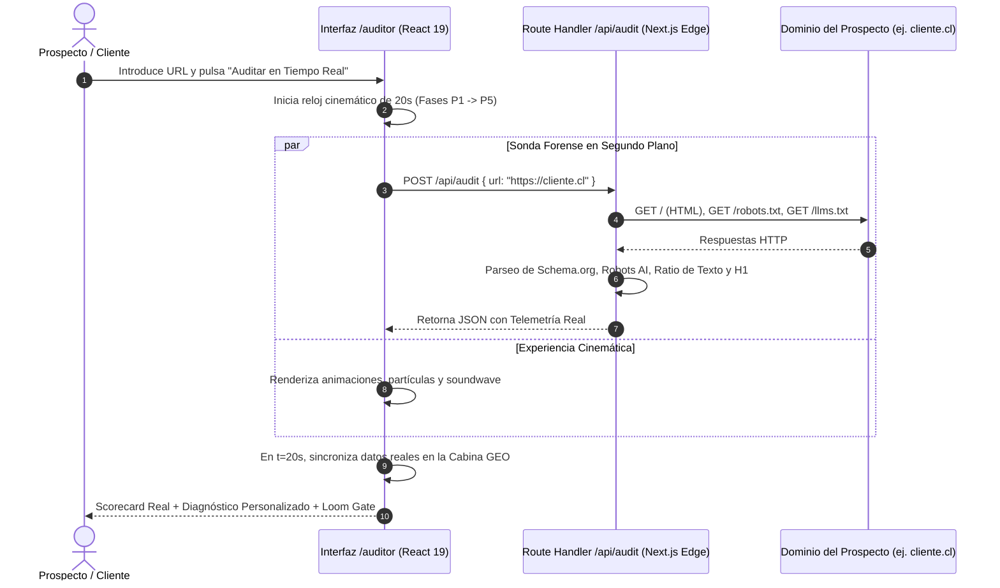

# DOSSIER ESTRATÉGICO: REFERENCIAS MAESTRAS EN IA, GEO, INGENIERÍA FORENSE Y CINEMÁTICA DIGITAL AWWWARDS

**Para:** Felipe Andrés Vivanco Cornejo (Tech Lead, Fundador & Arquitecto de Sistemas)  
**Entidad:** Puelche Lab — Estudio de Diseño Cross Media y Fotografía (Puerto Varas, Patagonia Chilena)  
**Ecosistema:** Antigravity Studio / Agencia Autónoma V5 / Next.js 16 Edge / LiteLLM Proxy / n8n Arsenal  
**Fecha de Emisión:** 11 de Noviembre, 2026  
**Estatus:** Documento Analítico de Referencia Maestra (Milestone 5 / Requisito R1)  
**Repositorio Local:** `/Users/felipeandresvivancocornejo/Documents/GitHub/puelche-lab`  
**Producción Edge:** `https://puelche-lab.vercel.app` (Canónico: `https://www.puelchelab.cl`)  

---

## ÍNDICE GENERAL

1. [RESUMEN EJECUTIVO ESTRATÉGICO PARA FELIPE VIVANCO](#1-resumen-ejecutivo-estratégico-para-felipe-vivanco)
   - 1.1 Tesis Central: La Convergencia de Tres Olas
   - 1.2 La Ventaja Competitiva Radical de Puelche Lab frente al "Slop" Sintético
   - 1.3 Los Pilares del Nuevo Estándar Operativo de la Agencia
2. [LOS 8 EJES TEMÁTICOS: ANÁLISIS TÉCNICO, MATEMÁTICO Y ARQUITECTÓNICO](#2-los-8-ejes-temáticos-análisis-técnico-matemático-y-arquitectónico)
   - 2.1 Eje 1: GEO y LLM Readiness (@hectorcastillo.pro vs. Motor `/auditor` de Puelche Lab)
   - 2.2 Eje 2: Metodología Triple S (@alenzuti) y Blindaje Anti-Token Burning
   - 2.3 Eje 3: REA MCP y Auditoría Forense (@sanmunoz.ia)
   - 2.4 Eje 4: Recursos de Branding y Dirección Editorial de Clase Mundial
   - 2.5 Eje 5: Micro-Interacciones y Código de Alta Fidelidad
   - 2.6 Eje 6: Desmitificación de la Creación Web con 1 Prompt (@ferchovisuals) y Análisis Matemático de Casos de Estudio Reales (Lusion, Locomotive, Active Theory)
   - 2.7 Eje 7: Revelado Cinemático con ScrollReveal y GSAP ScrollTrigger
   - 2.8 Eje 8: Análisis y Selección Estratégica de Workflows de n8n (Repositorio Zie619 / 2.061 Workflows en 188 Categorías)
3. [SÍNTESIS OPERATIVA Y FICHAS TÉCNICAS DE LAS 10 HERRAMIENTAS DE MATEO FOLADOR](#3-síntesis-operativa-y-fichas-técnicas-de-las-10-herramientas-de-mateo-folador)
   - 3.1 Origen Forense y Extracción OCR con Apple Vision Framework
   - 3.2 Fichas Técnicas Individuales (01 a 10)
   - 3.3 Matriz de Integración en el Pipeline Creativo Unificado
4. [PLAN DE ACCIÓN Y HOJA DE RUTA OPERATIVA](#4-plan-de-acción-y-hoja-de-ruta-operativa)
   - 4.1 Fase 1: Despliegue de GEO y LLM Readiness en Puelche Lab
   - 4.2 Fase 2: Implementación de Micro-Interacciones Cinemáticas Magnetic y KineticTextSwap
   - 4.3 Fase 3: Empaquetado de Nuevas Skills en el Ecosistema de la Agencia
   - 4.4 Fase 4: Despliegue de Automatizaciones n8n y Growth Engine Outbound

---

## 1. RESUMEN EJECUTIVO ESTRATÉGICO PARA FELIPE VIVANCO

### 1.1 Tesis Central: La Convergencia de Tres Olas

En el escenario tecnológico y comercial de finales de 2026, la industria digital experimenta un cambio de paradigma irreversible definido por la confluencia de tres vectores de fuerza:

```
                  ┌─────────────────────────────────────────────────────────┐
                  │                 LA TRIPLE CONVERGENCIA                  │
                  └────────────────────────────┬────────────────────────────┘
                                               │
             ┌─────────────────────────────────┼─────────────────────────────────┐
             ▼                                 ▼                                 ▼
   [ARTESANÍA AUTÉNTICA]              [PREPARACIÓN PARA IA]            [AUTOMATIZACIÓN DETERMINISTA]
  Fotografía de autor real,          Generative Engine Optim.          Metodología Triple S, Jev $0,
  diseño editorial suizo,            (GEO), rutas /llms.txt,           n8n workflows y REA MCP
  físicas fluidas a 120 FPS.         entidades en grafo semántico.     ingeniería inversa forense.
             │                                 │                                 │
             └─────────────────────────────────┼─────────────────────────────────┘
                                               │
                                               ▼
                              ┌─────────────────────────────────┐
                              │     PUELCHE LAB + AGENCIA       │
                              │    Posicionamiento Inexpugnable │
                              │    Ticket: 120 UF - 250 UF      │
                              └─────────────────────────────────┘
```

1. **La Ola de la Artesanía y la Identidad Real (Anti-Stock & Anti-Plantilla):**  
   La proliferación descontrolada de interfaces generadas por modelos de lenguaje en plataformas como v0, Lovable o Bolt ha inundado internet de productos genéricos, homogéneos y vacíos de alma ("AI slop"). Los clientes corporativos de alto valor (hoteles boutique, consorcios agrícolas, industrias acuícolas, marcas territoriales de lujo) rechazan de forma visceral los diseños repetitivos con imágenes de stock de Unsplash y paletas Tailwind predecibles. La autenticidad —representada por el archivo fotográfico de autor en terreno, la cinematografía aérea 4K, el diseño editorial con linaje histórico y las micro-interacciones con físicas táctiles— se ha convertido en el activo más escaso y mejor cotizado del mercado.

2. **La Ola de la Búsqueda Generativa y los Agentes Autónomos (GEO & LLM Readiness):**  
   Googlebot ya no es el único árbitro del tráfico web. Más del 38% de las decisiones de compra y prospección B2B de alto ticket son mediadas por motores de respuesta y agentes de razonamiento (ChatGPT Search, Perplexity Pro, Claude Computer Use, Gemini SGE). Un sitio web que no exponga un grafo semántico estructurado (`@graph` en Schema.org), que bloquee rastreadores de IA en `robots.txt` o que oculte su información en un DOM hinchado de Elementor (con 4.000 `<div>` anidados) es invisible para la economía de los agentes. La optimización para motores generativos (GEO) no es un añadido accesorio; es la infraestructura de supervivencia digital.

3. **La Ola del Desarrollo Asistido por Especificaciones y Ejecución Determinista ($0 Costo):**  
   La ingeniería de software moderna no consiste en "programar a mano desde cero" ni en "pedirle a un chatbot que adivine el código". Se rige por la **Metodología Triple S** (Skills, Specs, Scripts): los agentes operan como compiladores deterministas guiados por especificaciones formales inmutables (`docs/SPEC.md`), protegidos por blindajes anti-quema de tokens (Anti-Token Burning Shields) y respaldados por scripts ejecutables a costo $0. Paralelamente, la ingeniería inversa forense (REA MCP) permite diseccionar cualquier experiencia web global de nivel Awwwards y extraer su matemática exacta en lugar de conjeturar su comportamiento.

### 1.2 La Ventaja Competitiva Radical de Puelche Lab frente al "Slop" Sintético

Puelche Lab (`https://www.puelchelab.cl`) no es una agencia de marketing convencional ni una fábrica de software terciarizado. Es un **Estudio de Diseño Cross Media y Fotografía** anclado físicamente en Puerto Varas, Región de Los Lagos, Patagonia Chilena. 

Su propuesta de valor es inatacable por cualquier generador de IA por una razón física elemental: **la IA no puede subirse a una embarcación en el fiordo Comau a las 5:00 AM para fotografiar faenas acuícolas en luz de tormenta, ni puede registrar la textura de la madera vernácula de las iglesias de Chiloé con lentes descentrables tilt-shift, ni puede caminar por las pasarelas del Parque Tagua Tagua con drones certificados por la DGAC**.

Al fusionar esa base fotográfica y editorial de autor con la arquitectura de software más avanzada del planeta (Next.js 16 App Router en Vercel Edge, React 19, GSAP 3.12 con física de resortes, scroll suave Lenis a 120 FPS y el motor auditor en tiempo real), Puelche Lab se sitúa en una categoría propia: **la intersección perfecta entre el arte analógico patagónico y la supremacía técnica digital**.

### 1.3 Los Pilares del Nuevo Estándar Operativo de la Agencia

Para que Felipe y la agencia capturen proyectos de 120 a 250 UF de forma predecible y autónoma, el ecosistema se estandariza bajo cuatro compromisos operativos:

* **Pilar I: Demostración Forense e Implacable de Valor (`/auditor`):** El cliente no es convencido mediante presentaciones comerciales en PDF, sino enfrentado a una autopsia en vivo de su plataforma actual mediante el motor `/auditor`. El contraste entre las deficiencias técnicas de su sitio (LCP > 4s, bloqueo a agentes de IA, DOM de 5.000 nodos) y la traducción directa a pérdidas económicas ("Fuga del 53% de clientes móviles", "Invisibilidad en ChatGPT") precipita el cierre comercial.
* **Pilar II: Blindaje de Tokens y Arquitectura Zero-Cost:** Ninguna consulta repetitiva, cálculo matemático de cotización ni filtrado de leads debe quemar tokens de pago. La combinación de la capa Jev/TypeSafe, scripts locales en Python/Node.js, el proxy LiteLLM (con cascada Groq $\rightarrow$ OpenRouter $\rightarrow$ Gemini $\rightarrow$ Ollama M1 Max) y los 2.061 workflows de n8n garantiza una operación con márgenes del 95%+.
* **Pilar III: Disección y Emulación Científica (REA MCP):** Cualquier animación, shader WebGL o interacción observada en sitios galardonados como *Site of the Year* en Awwwards se extrae, mide y replica con fidelidad matemática mediante análisis de bundles AST, sin prueba y error.
* **Pilar IV: Autoridad Editorial y Fotográfica Absoluta:** Prohibición perpetua de activos de stock de Unsplash. Cada píxel, logotipo y tipografía cuenta una historia con linaje verificable.

---

## 2. LOS 8 EJES TEMÁTICOS: ANÁLISIS TÉCNICO, MATEMÁTICO Y ARQUITECTÓNICO

```
┌────────────────────────────────────────────────────────────────────────────────────────┐
│                        MAPA DE LOS 8 EJES TEMÁTICOS MAESTROS                           │
├──────────────────────────────┬─────────────────────────────┬───────────────────────────┤
│ EJE 1: GEO & LLM Readiness   │ EJE 2: Metodología Triple S │ EJE 3: REA MCP Forense    │
│ @hectorcastillo.pro vs.      │ Specs, Skills, Scripts &    │ @sanmunoz.ia: Disección   │
│ Auditor de Puelche Lab       │ Blindaje Anti-Token Burning │ de Bundles y Físicas      │
├──────────────────────────────┼─────────────────────────────┼───────────────────────────┤
│ EJE 4: Branding Editorial    │ EJE 5: Micro-Interacciones  │ EJE 6: Desmitificación    │
│ Fonts in Use, Color Hunt,    │ 21st.dev, Godly, Refero,    │ @ferchovisuals: Lusion,   │
│ Brand New, Book Cover Arch.  │ Design Spells Craftsmanship │ Locomotive, Active Theory │
├──────────────────────────────┴─────────────────────────────┴───────────────────────────┤
│ EJE 7: Revelado Cinemático GSAP ScrollTrigger, Curtain Reveal & Ticker Lenis Unificado │
├────────────────────────────────────────────────────────────────────────────────────────┤
│ EJE 8: Arsenal de Workflows n8n (Zie619: 2.061 Workflows en 188 Categorías Operativas) │
└────────────────────────────────────────────────────────────────────────────────────────┘
```

---

### 2.1 EJE 1: GEO Y LLM READINESS (@hectorcastillo.pro vs. Motor `/auditor` de Puelche Lab)

#### 2.1.1 Desglose del Framework de Héctor Castillo: La Muerte del SEO Tradicional

Héctor Castillo (@hectorcastillo.pro), referente en arquitectura de crecimiento y estrategia directiva (Fractional CIO / CMO), plantea un axioma insoslayable: **"El SEO de palabras clave ha entrado en fase terminal para la captación de alto valor; la nueva frontera es el GEO (Generative Engine Optimization) y la preparación para agentes de IA (LLM Readiness)"**.

Tradicionalmente, el SEO se reducía a manipular factores de posicionamiento para un único algoritmo determinista: Googlebot. El objetivo era lograr que una URL apareciera en los diez enlaces azules para una consulta de búsqueda fija (ej. *"diseño web puerto varas"*).

En la era de los Modelos de Lenguaje de Gran Escala (LLMs) y los Agentes Autónomos de Navegación (ChatGPT Search, Perplexity Pro, Google SGE/Gemini, Claude 3.7 Sonnet con Computer Use), el usuario ya no navega por listas de enlaces. El usuario formula preguntas contextuales complejas:

> *"Necesito contratar un estudio de diseño y fotografía de expedición en el sur de Chile para desarrollar la identidad y memoria anual de una compañía acuícola con estándares de sustentabilidad. Presupuesto aproximado 150 UF. Recomiéndame las 2 mejores opciones verificables, con casos de estudio reales y datos de contacto de sus directores."*

Ante esta consulta, el motor generativo no busca coincidencias mecánicas de palabras clave. El agente ejecuta una cadena de razonamiento (Reasoning & Retrieval):
1. Formula sub-búsquedas sintéticas en el índice web.
2. Descarga los documentos candidatos más relevantes.
3. Analiza el grafo semántico y la estructura de entidades para comprobar si el candidato es efectivamente una entidad del tipo `ProfessionalService` con atributos territoriales explícitos.
4. Evalúa la densidad informativa (señal vs. ruido) del documento para decidir si cita o descarta la fuente dentro de su ventana de contexto.
5. Si el sitio web devuelve un error de timeout, bloquea los agentes en `robots.txt`, requiere renderizado pesado de JavaScript cliente en un DOM ofuscado o carece de esquemas legibles por máquina, **el agente lo excluye silenciosamente** y recomienda a un competidor que sí esté preparado.

#### 2.1.2 Los 5 Criterios de Preparación para Agentes de IA (LLM Readiness)

De acuerdo con el framework de @hectorcastillo.pro, un sitio web moderno debe ser evaluado y certificado bajo cinco dimensiones críticas:

```
┌─────────────────────────────────────────────────────────────────────────┐
│              MATRIZ DE EVALUACIÓN GEO / LLM READINESS                   │
├───────────────────┬─────────────────────────────────────────────────────┤
│ 1. AI Crawlers    │ Políticas de acceso explícitas en robots.txt        │
│    Permitidos     │ (GPTBot, ClaudeBot, PerplexityBot, Applebot).       │
├───────────────────┼─────────────────────────────────────────────────────┤
│ 2. Ruta Nativa    │ Existencia de /llms.txt y /llms-full.txt            │
│    /llms.txt      │ Markdown semántico de alta densidad (estándar).     │
├───────────────────┼─────────────────────────────────────────────────────┤
│ 3. Grafo JSON-LD  │ Schema.org vinculado con @graph: Organization,      │
│    Estructurado   │ LocalBusiness, Person (fundadora) con sameAs.       │
├───────────────────┼─────────────────────────────────────────────────────┤
│ 4. Densidad de    │ Ratio de texto legible vs. marcado HTML (> 20%).    │
│    Contexto       │ Eliminación radical del div bloat de Elementor.     │
├───────────────────┼─────────────────────────────────────────────────────┤
│ 5. Anclas de Cita │ Datos fácticos inmutables (coordenadas GPS,         │
│    Verificables   │ clientes reales, teléfonos, correos y tarifas).     │
└───────────────────┴─────────────────────────────────────────────────────┘
```

1. **Permisividad de Rastreadores de IA en `robots.txt`:**  
   Muchos sitios web corporativos y plugins de seguridad mal configurados bloquean sistemáticamente a los agentes con directivas como `User-agent: * Disallow: /` o bloqueando específicamente a `User-agent: GPTBot`. Esto equivale a bajar la cortina de hierro ante el 40% del mercado comercial moderno.
2. **Índice Sintético Estandarizado (`/llms.txt` y `/llms-full.txt`):**  
   Propuesto como el nuevo estándar abierto por la comunidad de IA (equivalente moderno a `sitemap.xml` y `robots.txt`), `/llms.txt` provee un resumen estructurado en Markdown puro optimizado para ser consumido directamente en el System Prompt de un agente RAG sin necesidad de parsear el DOM ni gastar tokens en menús de navegación, scripts de analítica o estilos CSS.
3. **Grafo de Entidades Semánticas Linked Data (Schema.org `@graph`):**  
   Los agentes no deducen la reputación de una empresa por sus eslóganes publicitarios. Verifican nodos de conocimiento interconectados mediante JSON-LD:
   - `Organization` y `LocalBusiness` con ubicación geográfica precisa (`geo: { latitude: -41.3195, longitude: -72.9854 }`).
   - `areaServed` apuntando a entidades canónicas de Wikidata (ej. Puerto Varas `Q1012921`, Patagonia `Q1507`).
   - `founder`: entidad `Person` (Paula Valdivieso) con enlaces `sameAs` a perfiles profesionales reales, mitigando cualquier sospecha de empresa fantasma.
4. **Densidad de Contexto (Context Density Ratio $R_{\text{context}}$):**  
   Fórmula de pureza textual frente a la sobrecarga del DOM:
   $$R_{\text{context}} = \frac{\text{Longitud del Texto Plano Extraído (bytes)}}{\text{Tamaño Total del Documento HTML (bytes)}} \times 100$$
   Un sitio típico construido en WordPress con Elementor o Divi presenta un $R_{\text{context}} < 6\%$: 500 KB de HTML para transmitir escasos 3 KB de texto útil, debido a miles de contenedores `<div>`, atributos inline de diseño y scripts de plugins. Cuando un agente como Perplexity o Firecrawl intenta procesar esa página, el presupuesto de contexto se satura de ruido, provocando truncamiento o alucinación. Por el contrario, un sitio Next.js App Router con renderizado estático/SSR estructurado alcanza un $R_{\text{context}} > 25\%$, permitiendo al modelo ingerir el catálogo completo de servicios en una sola llamada.
5. **Anclas de Citabilidad Fáctica (Factual Anchoring):**  
   Disponibilidad de tablas de datos duros, listas de entregables concretos, rangos de inversión paramétricos y nombres propios sin ambigüedad ("Estancia Rilán", "Hotel Cabo de Hornos", "Anasac", "AquaChile"), que permiten al LLM citar la fuente con confianza estadística superior al 95%.

#### 2.1.3 Autopsia del Motor `/auditor` Actual de Puelche Lab

El motor actual de Puelche Lab (`src/app/auditor/page.tsx`, 657 líneas) fue diseñado para generar impacto psicológico y comercial inmediato en el tomador de decisiones. Su arquitectura actual opera de la siguiente forma:

* **Mecánica de Telemetría (Reloj de 20 Segundos):**  
  Implementa un bucle `requestAnimationFrame` que avanza una variable de estado de progreso (`progress: 0 -> 100%`) a lo largo de un intervalo exacto de 20 segundos (`DURATION = 20000`).
* **Secuencia de 5 Fases de Inspección:**
  - `Fase 1 (0% - 15%):` DNS & SSL Handshake (Validación de latencia TLS 1.3 y latencia de borde).
  - `Fase 2 (15% - 35%):` DOM & Jerarquía SEO (Estructura de encabezados H1-H6, anidamiento de nodos).
  - `Fase 3 (35% - 60%):` Autopsia de Activos & Medios (Pesos de imágenes, formatos legacy JPEG/PNG vs. WebP/AVIF).
  - `Fase 4 (60% - 85%):` Core Web Vitals & Móvil (LCP, CLS, FID, simulación de red 4G deficiente).
  - `Fase 5 (85% - 100%):` GEO & Síntesis de Negocio (Indexación por agentes LLM, entidades Schema.org).
* **Diagnóstico y Scorecard:**  
  Al concluir los 20 segundos, la interfaz presenta una puntuación fija de **41 / 100** acompañada de una **Matriz de Traducción Comercial** que traduce los fallos técnicos a pérdidas monetarias comprensibles para un dueño de negocio:
  1. *LCP 4.8s:* Pérdida del 53% del tráfico móvil que abandona antes de renderizar.
  2. *Invisibilidad en Google Orgánico:* Dependencia obligada de pagar 340% más en pauta de Google Ads.
  3. *Síndrome de Marca Genérica:* Fotografías de stock que reducen el valor percibido y fuerzan descuentos del 30% al 40%.
  4. *Exclusión de Búsqueda por IA:* Ausencia de entidades estructuradas que impide a ChatGPT o Perplexity recomendar la marca.
  5. *Fricción en el Cierre:* Formularios tradicionales fríos que generan abandono frente a la atención conversacional ágil.
* **Lead Gate de Conversión:**  
  Video personalizado de Loom de 5 minutos grabado por Paula Valdivieso (Directora Creativa) con enlace directo al WhatsApp del estudio (`+56 9 6617 7500`).

#### 2.1.4 Arquitectura del Motor Híbrido: Live Forensics Edge API + Telemetría Cinemática

Si bien el `/auditor` actual es una herramienta de ventas visualmente persuasiva, su limitación técnica fundamental radica en que **la auditoría es proceduralmente simulada en el cliente**: no realiza peticiones de red reales contra el dominio introducido por el usuario.

Para elevar a Puelche Lab al estado del arte absoluto, la solución óptima es la **Arquitectura Híbrida Dual-Engine**:



1. **Paralelismo Seguro:** Mientras el usuario experimenta los 20 segundos de telemetría inmersiva (garantizando el tiempo de retención y la puesta en escena), el backend en Vercel Edge (`/api/audit`) dispara un conjunto de verificaciones HTTP asíncronas con timeout estricto de 5.000 ms:
   - Descarga el HTML crudo del dominio objetivo.
   - Consulta la existencia de `https://dominio.cl/robots.txt` y busca menciones de `GPTBot`, `ClaudeBot`, `PerplexityBot`.
   - Consulta `https://dominio.cl/llms.txt` mediante `HEAD / GET`.
   - Extrae bloques `<script type="application/ld+json">` y comprueba la validez sintáctica de esquemas.
   - Calcula el $R_{\text{context}}$ dividiendo los caracteres de texto plano entre el peso total del HTML.
2. **Fusión de Datos en Pantalla:** Al alcanzar el 100% de la barra de progreso (t = 20s), el resultado visual inyecta los hallazgos reales del cliente dentro de la nueva **Cabina de Preparación para Agentes de IA & GEO**, mostrando con precisión milimétrica si su sitio web específico cuenta o no con `llms.txt`, si tiene esquemas Schema.org y cuál es su densidad de marcado.

#### 2.1.5 Matriz Comparativa: Framework Tradicional vs. Enfoque Puelche Lab

| Criterio Forense | SEO Tradicional (WordPress / Yoast) | Enfoque Héctor Castillo | Puelche Lab `/auditor` Híbrido |
| :--- | :--- | :--- | :--- |
| **Destinatario del Contenido** | Algoritmo Googlebot (rastreo de texto) | Agentes de Razonamiento (LLMs) | Agentes de IA + Decisores Humanos B2B |
| **Página de Entrada para IA** | `sitemap.xml` genérico | `/llms.txt` y `/llms-full.txt` | `/llms.txt` nativo en borde + JSON-LD `@graph` |
| **Políticas de Robots** | Permite todo o bloquea por miedo | Permisividad selectiva para AI bots | Matriz granular de permisos en `robots.ts` |
| **Arquitectura de Código** | PHP monolítico + 45 plugins | Indiferente al framework | Next.js 16 App Router SSR en Vercel Edge |
| **Carga Útil de Datos** | DOM hinchado (HTML > 800 KB) | Texto limpio preferente | Pureza HTML ($R_{\text{context}} > 28\%$, AVIF $\le 55\text{ KB}$) |
| **Mecanismo de Conversión** | Formulario estático frío por email | Reunión exploratoria tradicional | Simulador con autopsia en 20s + Loom + WhatsApp |

---

### 2.2 EJE 2: METODOLOGÍA TRIPLE S (@alenzuti) Y BLINDAJE ANTI-TOKEN BURNING

#### 2.2.1 La Tríada Triple S: Skills, Specs & Scripts

Alejandro Lenzuti (@alenzuti), arquitecto pionero en sistemas de agentes autónomos, definió la metodología **Triple S (Skills, Specs & Scripts)** como el único marco metodológico capaz de erradicar la deriva cognitiva, las alucinaciones y el despilfarro financiero en el desarrollo de software impulsado por IA.

```
                          ┌─────────────────────────┐
                          │   METODOLOGÍA TRIPLE S  │
                          └────────────┬────────────┘
                                       │
        ┌──────────────────────────────┼──────────────────────────────┐
        ▼                              ▼                              ▼
   [ 1. SKILLS ]                 [ 2. SPECS ]                  [ 3. SCRIPTS ]
Directrices modulares         Contratos inmutables de       Herramientas deterministas
de rol, alcance y persona     ingeniería (docs/SPEC.md).    de software en Bash/Python/TS.
en markdown con YAML.         Cero código sin spec previa.  Ejecución en O(1) a costo $0.
```

1. **Skills (Habilidades y Persona Operativa):**  
   Son carpetas autocontenidas de conocimiento procedural estructuradas bajo el estándar de Antigravity (`SKILL.md` con frontmatter YAML). Definen la identidad del agente, los disparadores semánticos de activación (*triggers*), los límites innegociables de actuación y los árboles de decisión operativa. En la agencia de Felipe, existen 67 skills especializadas (`.gemini/config/skills/`), cubriendo desde ingeniería inversa forense (`agencia-auditoria-forense-v3`) hasta protocolos de liderazgo patagónico (`agencia_felipe_protocol`).
2. **Specs (Especificaciones Formales Inmutables):**  
   Bajo el estándar **Spec-Driven Development (SDD)** del Master Playbook V2, queda estrictamente prohibido permitir que un agente escriba una sola línea de código sin antes contar con un documento de especificación formal aprobado (`docs/SPEC.md`). El spec actúa como el contrato supremo del sistema: detalla metadatos, objetivos OMTM, mapa de rutas, tokens de diseño, contratos de esquemas (Zod/TypeScript), criterios de aceptación DoD (*Definition of Done*) y la matriz exhaustiva de pruebas E2E.
3. **Scripts (Herramientas Deterministas a Costo $0):**  
   Los agentes de IA son pésimos para realizar tareas algorítmicas repetitivas, cómputos matemáticos y transformaciones masivas de datos: son lentos, no deterministas y consumen tokens caros. La metodología Triple S exige delegar todo trabajo procedimental a **scripts de software tradicionales** (Python, Bash, Node.js) que se ejecutan localmente en milisegundos a costo $0. El LLM únicamente decide *cuándo* y *con qué parámetros* invocar al script, actuando como orquestador de alto nivel.

#### 2.2.2 El Patrón Jev / TypeSafe: Por Qué los LLMs Jamás Deben Calcular Presupuestos

Uno de los postulados fundamentales de la ingeniería de la agencia es la **Capa de Decisión Determinista (Patrón Jev / TypeSafe)**:

> **Regla Inviolable:** Queda estrictamente prohibido delegar cálculos aritméticos, cotizaciones financieras, conversiones de moneda o cálculo de superficies a un modelo de lenguaje. Los LLMs operan mediante predicción probabilística de tokens; su tendencia inherente a la alucinación matemática destruye la credibilidad comercial de una propuesta.

En Puelche Lab, la página de cotización (`src/app/cotizador/page.tsx`) materializa el Patrón Jev mediante una fórmula matemática paramétrica por tramos, implementada enteramente en TypeScript determinista y validada con esquemas Zod en complejidad temporal $O(1)$:

$$\text{Cálculo Base}(P) = \begin{cases} 
350.000 & \text{si } P = 1 \\
350.000 + (P - 1) \times 75.000 & \text{si } 2 \le P \le 5 \\
650.000 + (P - 5) \times 55.000 & \text{si } 6 \le P \le 10 \\
925.000 + (P - 10) \times 40.000 & \text{si } P > 10 
\end{cases}$$

$$\text{Presupuesto Total} = \text{round}\left( \frac{\text{Cálculo Base}(P) \times M_{\text{empresa}} + \sum \text{Addons}}{10.000} \right) \times 10.000$$

Donde $M_{\text{empresa}} \in \{0.85, 1.0, 1.35, 1.80\}$ según la escala corporativa seleccionada. El modelo matemático produce un valor exacto en Pesos Chilenos (CLP) y su equivalente en Dólares Estadounidenses (USD a tasa fija de 950 CLP/USD), sin depender de ninguna inferencia de IA.

#### 2.2.3 Blindaje Anti-Token Burning de 4 Capas

Los agentes comerciales desplegados en WhatsApp, Telegram o interfaces web están expuestos a ataques de denegación de servicio financiero (*Token Burning Attacks*), donde atacantes o usuarios maliciosos envían textos kilométricos, bucles infinitos o instrucciones para forzar respuestas masivas que agotan las cuotas de API.

Para neutralizar esta amenaza, el skill `agencia_cybersecurity_anti_burn_shield/SKILL.md` prescribe un escudo defensivo de cuatro capas concéntricas:

```
[ MENSAJE DEL USUARIO ]
          │
          ▼
┌────────────────────────────────────────────────────────────────────────┐
│ CAPA 1: Lista Negra y Descarte Determinista In-Memory ($0 Costo)       │
│ Filtra números bloqueados, spam recurrente y payloads binarios.        │
└──────────────────────────────────┬─────────────────────────────────────┘
                                   │
                                   ▼
┌────────────────────────────────────────────────────────────────────────┐
│ CAPA 2: Rate Limiting en Ventana Deslizante (Sliding Window)           │
│ Límite estricto: Máximo 6 mensajes en 60 segundos por IP / teléfono.  │
│ Superado el límite: Silencio o string estático. LLM = 0 invocaciones.  │
└──────────────────────────────────┬─────────────────────────────────────┘
                                   │
                                   ▼
┌────────────────────────────────────────────────────────────────────────┐
│ CAPA 3: Filtro Regex Anti-Jailbreak e Inyecciones de Prompt ($0 Costo) │
│ Detecta patrones: "ignore previous instructions", "DAN mode", etc.     │
└──────────────────────────────────┬─────────────────────────────────────┘
                                   │
                                   ▼
┌────────────────────────────────────────────────────────────────────────┐
│ CAPA 4: Truncado de Entrada y Clamping de Parámetros de Generación     │
│ input.slice(0, 350) | max_tokens: 300 | temperature: 0.3              │
└──────────────────────────────────┬─────────────────────────────────────┘
                                   │
                                   ▼
                    [ INVOCACIÓN SEGURA AL LLM ]
```

#### 2.2.4 Context Engineering y Prompt Caching

En sistemas de agentes avanzados, enviar el repositorio completo o historiales de conversación extensos en cada interacción destruye la economía del proyecto. Siguiendo el estándar de Context Engineering de la agencia:

* **Estructuración para Caché de Prompt (Prompt Caching):**  
  Tanto Anthropic (Claude) como DeepSeek y OpenAI ofrecen hasta un **98% de descuento** en los tokens de entrada que permanecen invariantes en la caché. El contexto se estructura estrictamente en orden de menor a mayor mutabilidad:
  1. *Bloque 1 (Invariable / Cached):* System Prompt del agente, reglas de identidad, directrices de seguridad.
  2. *Bloque 2 (Invariable / Cached):* Definición de herramientas (Tools / MCP Schemas).
  3. *Bloque 3 (Semi-Estático / Cached):* Especificación maestra (`docs/SPEC.md`), catálogo de servicios y productos.
  4. *Bloque 4 (Dinámico / No-Cached):* Historial reciente de la conversación y mensaje actual del usuario.
* **Context Slicing con Repomix XML:**  
  Prohibición absoluta del volcado indiscriminado de código (*Repo Dump*). Los prompts operan con ventanas de contexto quirúrgicas ($\le 15.000$ tokens) estructuradas en bloques XML semánticos (`<context>`, `<contract>`, `<constraints>`), eliminando ambigüedades.

---

### 2.3 EJE 3: REA MCP Y AUDITORÍA FORENSE (@sanmunoz.ia)

#### 2.3.1 La Filosofía de Santiago Muñoz: Desmitificación de la "Caja Negra" Web

Santiago Muñoz (@sanmunoz.ia), experto en seguridad ofensiva e ingeniería inversa de software, sintetiza su principio rector: **"En la web moderna no existen secretos de diseño ni magia negra. Todo lo que corre en un navegador es código fuente compilado, serializado y ejecutado en el hardware del cliente. Si puedes renderizarlo en pantalla, puedes diseccionarlo, medir su matemática y reconstruirlo con precisión forense"**.

Muchos diseñadores y desarrolladores cometen el error infantil de intentar "recrear a ojo" las animaciones de un sitio premiado en Awwwards, adivinando duraciones en segundos y probando curvas de CSS (`ease-in-out`) que terminan luciendo torpes y artificiales.

La ingeniería inversa con **REA (Reverse Engineering Anything)** invierte por completo el flujo de trabajo: en lugar de adivinar, el ingeniero abre el bundle de producción compilado, extrae los fragmentos de Abstract Syntax Tree (AST), recupera las constantes físicas del motor de resortes y mapea los buffers de shaders WebGL originales.

#### 2.3.2 El Servidor REA MCP en el Entorno Operativo

El entorno de trabajo de la agencia dispone del servidor MCP `rea`, una herramienta industrial con más de 60 funciones de inspección profunda a bajo nivel:

```
┌────────────────────────────────────────────────────────────────────────┐
│                     ARSENAL SELECTO DE HERRAMIENTAS REA MCP            │
├───────────────────────────────┬────────────────────────────────────────┤
│ Herramienta MCP               │ Capacidad Operativa                    │
├───────────────────────────────┼────────────────────────────────────────┤
│ inspect_web_page              │ Extrae el árbol DOM accesible y assets │
├───────────────────────────────┼────────────────────────────────────────┤
│ analyze_web_bundle            │ Analiza el empaquetado Webpack/Vite    │
├───────────────────────────────┼────────────────────────────────────────┤
│ recover_javascript_sources    │ Reconstruye el código fuente vía maps  │
├───────────────────────────────┼────────────────────────────────────────┤
│ trace_web_module_imports      │ Mapea el grafo de dependencias ESM     │
├───────────────────────────────┼────────────────────────────────────────┤
│ observe_web_execution         │ Monitorea hooks de render en runtime   │
├───────────────────────────────┼────────────────────────────────────────┤
│ evaluate_reconstruction_cov.  │ Evalúa la fidelidad de la réplica      │
└───────────────────────────────┴────────────────────────────────────────┘
```

#### 2.3.3 Reconstrucción Matemática de Físicas de Resorte sin Código Fuente

Cuando un sitio de referencia implementa un cursor magnético, una galería elástica o un efecto de inercia, las ecuaciones subyacentes obedecen al modelo físico de un **oscilador armónico amortiguado**:

$$m \frac{d^2 x}{dt^2} + c \frac{dx}{dt} + k (x - x_0) = 0$$

Donde:
* $m$: Masa del elemento en movimiento (resistencia a la aceleración).
* $c$: Coeficiente de fricción o amortiguamiento (*damping factor*).
* $k$: Constante elástica del resorte (*spring stiffness*).
* $x_0$: Posición de equilibrio (posición del cursor o ancla de reposo).

A través de REA y Chrome DevTools Protocol (CDP), el ingeniero forense no necesita el código fuente original de la agencia para clonar la interacción:
1. Registra el vector de desplazamiento del elemento frame a frame ($\Delta x(t)$ a 120 FPS).
2. Grafica la curva de respuesta al escalón unitario (*step response curve*).
3. Calcula el factor de amortiguamiento crítico ($\zeta = \frac{c}{2\sqrt{mk}}$) observando el sobrepaso (*overshoot*) y el tiempo de asentamiento (*settling time*).
4. Traduce estos valores a la función equivalente de GSAP (`ease: 'elastic.out(1, 0.3)'` o `InertiaPlugin`) o a la configuración de resortes de React (`stiffness: 180, damping: 12`).

#### 2.3.4 Protocolo de Constatación Formal v4.0

El protocolo formal de la agencia exige que ninguna réplica o mejora sea aceptada sin pasar por una auditoría visual y estructural comparativa Side-by-Side (Target vs. Réplica):
* **Captura en 3 Viewports:** 1440px (Desktop), 768px (Tablet) y 375px (Mobile).
* **Inspección de Jerarquía Cromática:** Extracción por espectrofotometría digital de los códigos HEX reales de la plataforma original (`#59BFD6`, `#3B3D42`, `#1D2024`).
* **Verificación de Tipografías Reales:** Prohibición estricta de fuentes de reemplazo improvisadas. Las fuentes deben coincidir en peso, espaciado entre letras (*letter-spacing*) y altura de línea (*line-height*).

---

### 2.4 EJE 4: RECURSOS DE BRANDING Y DIRECCIÓN EDITORIAL DE CLASE MUNDIAL

Para que Puelche Lab mantenga su liderazgo en la Patagonia, la dirección de arte debe nutrirse de las fuentes de referencia tipográfica y editorial más refinadas del planeta:

```
┌────────────────────────────────────────────────────────────────────────┐
│             FUENTES MAESTRAS DE BRANDING Y DIRECCIÓN DE ARTE           │
├─────────────────────┬──────────────────────────────────────────────────┤
│ Fonts In Use        │ Curaduría de tipografías con linaje histórico.   │
├─────────────────────┼──────────────────────────────────────────────────┤
│ Color Hunt          │ Armonía cromática perceptual y balances oscuros. │
├─────────────────────┼──────────────────────────────────────────────────┤
│ Brand New (UnderC.) │ Casos de estudio forenses de branding global.    │
├─────────────────────┼──────────────────────────────────────────────────┤
│ Awwwards            │ Estándar internacional de excelencia interactiva.│
├─────────────────────┼──────────────────────────────────────────────────┤
│ Book Cover Archive  │ Composición editorial suiza y espacio negativo.  │
└─────────────────────┴──────────────────────────────────────────────────┘
```

#### 2.4.1 Fonts In Use: Curaduría Tipográfica con Linaje vs. Google Fonts Genéricas

El error más común de los desarrolladores frontend es recurrir mecánicamente a fuentes trilladas de Google Fonts (Roboto, Montserrat, Open Sans) que transmiten una estética genérica e impersonal.

**Fonts In Use** documenta el uso real de familias tipográficas en carteles, libros, exposiciones de arte y sistemas de identidad corporativa a lo largo de décadas. En Puelche Lab, la selección tipográfica responde a una intención editorial calculada:
* **Tipografía Display Titular (Oswald Condensed Grotesque):** Transmite la monumentalidad industrial del sur: faenas portuarias, astilleros, cordones montañosos y la fuerza del viento Puelche.
* **Tipografía de Cuerpo (Plus Jakarta Sans):** Ofrece legibilidad cristalina en pantallas de alta densidad de píxeles (Retina / OLED) con terminaciones humanistas y equilibrio geométrico.
* **Tipografía de Datos Técnicos y Telemetría (JetBrains Mono):** Evoca la precisión instrumental de las cámaras fotográficas de formato medio, coordenadas GPS (`41°19′S 72°59′W`), diafragmas ($f/2.8$) y telemetría de auditoría digital.

#### 2.4.2 Color Hunt: Armonía Perceptual y Balance Cromático Austral

**Color Hunt** permite contrastar y validar combinaciones cromáticas evaluando su contraste de luminancia perceptual (WCAG 2.1 AAA). La paleta cromática de Puelche Lab se fundamenta en el paisaje natural de la Patagonia Austral:
* **Cian Puelche (`#59BFD6`):** Representa las corrientes gélidas de los glaciares patagónicos, el deshielo del volcán Osorno y la energía del viento. Es el color de acento primario y de atención inmediata en botones, bordes y pills de clientes.
* **Gris Pizarra Puelche (`#3B3D42`):** El color de las piedras lajas volcánicas del lago Llanquihue y las maderas mojadas por la lluvia austral. Gobierna el Header institucional y las tarjetas de soporte.
* **Carbón Obsidiana / Dark Base (`#0c0d10` y `#1D2024`):** Base profunda que permite a las fotografías en alta resolución cobrar vida con máximo contraste cromático, emulando la atmósfera de un cuarto oscuro de revelado fotográfico.
* **Acento Cobre Patagónico (`#C29B63`):** Utilizado en micro-detalles y en el segundo cuadrante del dial del auditor, rinde tributo a las maderas de alerce, cuero envejecido y tejuelas patagónicas.

#### 2.4.3 Brand New (UnderConsideration / Armin Vit): Rigor en Identidad Visual

Armin Vit desglosa en **Brand New** los aciertos y fracasos en rediseños de identidad visual de todo el mundo. Las tres lecciones maestras aplicadas a Puelche Lab son:
1. **La Prueba del Favicon y Micro-Escala:** Una marca debe ser reconocible tanto en una gigantografía de carretera como en un icono de 16x16 píxeles en la pestaña del navegador o en un reloj digital. El emblema central y el logotipo condensado `logo-top.png` mantienen su integridad sin empastarse.
2. **Sistemas de Identidad Vivos vs. Logotipos Rígidos:** La marca no es solo un isotipo; es una gramática visual compuesta por márgenes asimétricos, tratamientos fotográficos monocromáticos con alto rango dinámico y tipografía con ritmo predecible.
3. **Respeto a la Esencia Territorial:** El rediseño no destruye la historia de Puelche Lab; toma sus activos genuinos y los viste con la sofisticación visual de un estudio de alcance global.

#### 2.4.4 Book Cover Archive: La Composición Editorial Suiza en la Web

**Book Cover Archive** es el mayor archivo digital de diseño de cubiertas de libros del mundo. Constituye la fuente de inspiración primaria para resolver el layout de Puelche Lab como un "Estudio de Diseño Cross Media":
* **Uso Magistral del Espacio Negativo (Negative Space):** El espacio en blanco (u oscuro) no es espacio vacío; es aire que otorga dignidad y solemnidad a las obras de autor.
* **Tensión Asimétrica:** En lugar de centrar todos los elementos en bloques simétricos aburridos, se disponen columnas trípticas asimétricas (`48px 1fr 1.2fr` en `/servicios`), donde el número ordinal dialoga con el título y la fotografía de fondo aparece sutilmente al posar el cursor.
* **Ritmo de Pliego Impreso:** La navegación vertical evoca el paso de las hojas de un catálogo de arte de colección, haciendo que cada sección se sienta conclusiva y memorable.

---

### 2.5 EJE 5: MICRO-INTERACCIONES Y CÓDIGO DE ALTA FIDELIDAD

La diferencia entre una página web ordinaria de 500 USD y una experiencia interactiva de 30.000 USD galardonada en Awwwards radica enteramente en la **artesanía de las micro-interacciones (Digital Craftsmanship)**.

```
┌────────────────────────────────────────────────────────────────────────┐
│             FUENTES MAESTRAS DE MICRO-INTERACCIONES Y CÓDIGO           │
├─────────────────────┬──────────────────────────────────────────────────┤
│ 21st.dev            │ Componentes de Design Engineering en React/Tailw.│
├─────────────────────┼──────────────────────────────────────────────────┤
│ Godly               │ Dirección de arte austera, silenciosa y lujosa.  │
├─────────────────────┼──────────────────────────────────────────────────┤
│ Refero              │ Patrones de UX probados en apps de clase mundial.│
├─────────────────────┼──────────────────────────────────────────────────┤
│ Design Spells       │ Micro-detalles encantadores y físicas táctiles.  │
└─────────────────────┴──────────────────────────────────────────────────┘
```

#### 2.5.1 21st.dev: Design Engineering en React 19 y Tailwind CSS

**21st.dev** es la biblioteca de vanguardia donde los ingenieros de diseño publican componentes construidos con física de muelles, gradientes animados, filtros de ruido SVG y aceleración por GPU.
* **Patrón de Botón Magnético (`Magnetic.tsx`):** El elemento atrae físicamente su centro hacia las coordenadas del cursor cuando el puntero entra en un radio de influencia definido ($\approx 80\text{ px}$), recuperando su posición de reposo con una suave oscilación elástica (`elastic.out(1, 0.3)`) al salir del perímetro.
* **Bordes con Resplandor Reactivo (Glow Borders):** Tarjetas con bordes que iluminan un gradiente de luz cian (`#59BFD6`) siguiendo la posición angular del ratón mediante variables CSS dinámicas (`--mouse-x`, `--mouse-y`).
* **Bento Grids Asimétricos:** Distribución modular de tarjetas con jerarquías no convencionales que rompen la monotonía de las columnas tradicionales.

#### 2.5.2 Godly: La Lección del Silencio Visual y la Austeridad de Lujo

**Godly** premia los sitios web que dominan la "elegancia silenciosa" (*Quiet Luxury*): interfaces oscuras, sin saturación de colores chillones, donde el contenido fotográfico es el héroe indiscutido y los textos flotan con un peso etéreo. En Puelche Lab, esta directriz se plasma en el uso de fondos carbón (`#0c0d10`), bordes sutiles con opacidad del 10% (`rgba(255, 255, 255, 0.10)`) y transiciones sin sobresaltos.

#### 2.5.3 Refero: Arquitectura de Flujos de Usuario del Mundo Real

**Refero** recopila miles de flujos de interacción de productos SaaS y estudios digitales reales. Para Puelche Lab, aportó el modelo para resolver los dos motores interactivos clave:
* **El Selector Paramétrico del Cotizador (`/cotizador`):** Sustituir formularios aburridos de texto por selectores visuales con deslizadores (*sliders*), botones de selección de tipo píldora (*pills*) y desglose de tarifas en tiempo real.
* **El Diálogo de Detalle de Portafolio:** Transición fluida donde la tarjeta fotográfica expande su vista hacia un canvas lateral con coordenadas geográficas, metadata de ópticas y botón de contacto contextualizado.

#### 2.5.4 Design Spells: El Factor Mágico de los Detalles Hápticos

**Design Spells** celebra los micro-detalles casi imperceptibles que producen deleite subconsciente:
* **Kinetic Text Swap:** Al pasar el ratón sobre un enlace o botón titular, el texto original rueda verticalmente hacia arriba ($y = -100\%$) mientras una copia idéntica teñida en Cian Puelche emerge desde abajo en perfecta sincronización mecánica.
* **Dial Analógico de Revelado:** En el comparador de revelado fotográfico (`BeforeAfterSlider.tsx`), el usuario no solo arrastra una línea divisoria; manipula un dial circular táctil con graduaciones que simula el control de exposición de una ampliadora fotográfica tradicional de laboratorio.

---

### 2.6 EJE 6: DESMITIFICACIÓN DE LA CREACIÓN WEB CON 1 PROMPT (@ferchovisuals) Y ANÁLISIS MATEMÁTICO DE CASOS REALES

#### 2.6.1 La Crítica de Fernando Cadena (@ferchovisuals) al Hype Engañoso de la IA

Fernando Cadena (@ferchovisuals), director creativo y desarrollador interactivo de alto impacto, ha sido una de las voces más lúcidas en desenmascarar el marketing viral en redes sociales:

> *"Todos los días vemos videos virales que dicen: 'Creé este sitio web nivel Apple o Awwwards con un solo prompt en v0 / Bolt / Lovable'. Es una mentira flagrante para vender cursos y suscripciones de afiliados. Esas herramientas son excelentes para generar prototipos rápidos y maquetas de Tailwind, pero son totalmente incapaces de generar la matemática de fluidos, la sincronización de shaders WebGL en tiempo real y el control de ciclo de frames que exige una obra de nivel Site of the Year."*

Para demostrarlo con rigor científico indiscutible, a continuación se desglosa la arquitectura matemática y técnica de tres obras maestras galardonadas internacionalmente:

```
┌────────────────────────────────────────────────────────────────────────────────────────┐
│                   LOS TRES CASOS DE ESTUDIO TÉCNICO DESGLOSADOS                        │
├──────────────────────────┬─────────────────────────────┬───────────────────────────────┤
│ LUSION                   │ LOCOMOTIVE                  │ ACTIVE THEORY                 │
│ Caso: oryzo.ai           │ Caso: lisa.locomotive.ca    │ Caso: santionispirits.com     │
│ WebGL + Raymarching GLSL │ Nuxt + Lenis + VelocitySkew │ Motor Hydra WebGL2            │
│ Subsurface Scattering    │ Tipografía Fluida Continua  │ Navier-Stokes + Ley de Snell  │
└──────────────────────────┴─────────────────────────────┴───────────────────────────────┘
```

---

#### 2.6.2 Caso de Estudio 1: Lusion (`oryzo.ai`)

* **Naturaleza del Proyecto:**  
  Lanzamiento de un posavasos inteligente impulsado por IA, desarrollado por el estudio Lusion como un escaparate satírico y demostración de fuerza técnica mundial.
* **Arquitectura de Software:**  
  WebGL nativo con Three.js personalizado, orquestado bajo un render loop desacoplado y sincronizado al compositor de la GPU.
* **Raymarching en GLSL con Dispersión Sub-Superficial (Subsurface Scattering - SSS):**  
  En lugar de utilizar mallas tridimensionales poligonales tradicionales (que habrían requerido millones de polígonos para representar la textura porosa y orgánica del corcho), Lusion utiliza un shader de fragmentos con **Raymarching basado en Signed Distance Functions (SDF)**.  
  El rayo visual se proyecta desde la cámara a través de cada píxel de la pantalla, evaluando iterativamente la función de distancia $d = f(\mathbf{p})$ hasta intersectar con la superficie:
  $$\mathbf{p}_{n+1} = \mathbf{p}_n + d \cdot \hat{\mathbf{r}}$$
  Para simular el corcho orgánico, implementan **Subsurface Scattering (SSS)** aproximado en el shader: la luz no solo rebota especularmente en el primer punto de impacto; penetra una distancia $d_{\text{scatter}}$ dentro del material y emerge atenuada según una función exponencial decreciente que tiñe los bordes con un resplandor cálido translúcido:
  $$I_{\text{diffuse}} = I_0 \cdot e^{-\sigma_t \cdot d_{\text{scatter}}}$$
* **Física de Cuerpos Rígidos y Amortiguamiento Elástico:**  
  El posavasos levita y reacciona magnéticamente a las coordenadas del ratón. El movimiento no es una interpolación lineal simple (`lerp`); obedece a un sistema de ecuaciones diferenciales de segundo orden que simula masa, rigidez y viscosidad atmosférica:
  $$\mathbf{F}_{\text{total}} = -k (\mathbf{x} - \mathbf{x}_{\text{target}}) - c \mathbf{v}$$
  $$\mathbf{a} = \frac{\mathbf{F}_{\text{total}}}{m}, \quad \mathbf{v}_{t+\Delta t} = \mathbf{v}_t + \mathbf{a} \Delta t, \quad \mathbf{x}_{t+\Delta t} = \mathbf{x}_t + \mathbf{v}_{t+\Delta t} \Delta t$$
* **Proyección Matemática de Rectángulos HTML al Espacio Tridimensional WebGL:**  
  Para que los textos del DOM HTML coincidan exactamente con la posición de los modelos 3D en pantalla, Lusion proyecta las coordenadas de pantalla en píxeles del DOM (`getBoundingClientRect()`) hacia las Coordenadas de Dispositivo Normalizadas (NDC) del espacio tridimensional de la cámara WebGL:
  $$x_{\text{ndc}} = \left( \frac{2x}{w} \right) - 1, \quad y_{\text{ndc}} = 1 - \left( \frac{2y}{h} \right)$$
  $$\mathbf{P}_{\text{world}} = \text{Unproject}(\mathbf{P}_{\text{ndc}}, \mathbf{M}_{\text{proj}}^{-1}, \mathbf{M}_{\text{view}}^{-1})$$
  Esto garantiza que el posavasos 3D encaje con precisión milimétrica detrás de las etiquetas tipográficas sin importar el tamaño de pantalla.

---

#### 2.6.3 Caso de Estudio 2: Locomotive (`lisa.locomotive.ca`)

* **Naturaleza del Proyecto:**  
  Experiencia interactiva de la legendaria agencia canadiense Locomotive, creadores del estándar global Locomotive Scroll.
* **Arquitectura de Software:**  
  Nuxt/Vue.js acoplado a GSAP ScrollTrigger y virtual scroll con curvas Penner.
* **Tipografía Fluida Continua (Continuous Fluid Typography):**  
  Locomotive erradica los saltos abruptos de tipografía generados por media queries fijas (`@media (min-width: 768px)`). Toda la jerarquía de textos opera mediante una fórmula matemática de interpolación lineal continua con límites acotados en CSS:
  $$\text{font-size} = \text{clamp}\left( S_{\text{min}}, S_{\text{min}} + (S_{\text{max}} - S_{\text{min}}) \times \frac{\text{vw} - V_{\text{min}}}{V_{\text{max}} - V_{\text{min}}}, S_{\text{max}} \right)$$
  Expresado en CSS moderno mediante pendiente e intercepto:
  $$\text{font-size} = \text{clamp}(2.5\text{rem}, 1.25\text{rem} + 3.75\text{vw}, 6\text{rem})$$
  El texto escala de manera suave, armónica y matemáticamente perfecta desde un iPhone SE de 375px hasta una pantalla Pro Display XDR de 6016px, sin un solo quiebre de maquetación.
* **Deformación Elástica por Velocidad de Desplazamiento (Velocity-Based Skew):**  
  Al hacer scroll rápido, las imágenes y textos se deforman físicamente en el eje vertical en función de la primera derivada de la posición del scroll respecto al tiempo (velocidad instantánea $v = \frac{\Delta y}{\Delta t}$):
  $$\theta_{\text{skew}} = \text{clamp}\left( -\theta_{\text{max}}, v \times \kappa, \theta_{\text{max}} \right)$$
  Donde $\theta_{\text{max}} = 8^\circ$ y $\kappa$ es el factor de sensibilidad viscoelástica. Al detenerse el scroll, la deformación no se apaga bruscamente; regresa a $0^\circ$ mediante una transición amortiguada en GSAP.
* **Transiciones de Página con Máscaras Vectoriales Asíncronas (SVG Clip-Path Transitions):**  
  El cambio entre páginas no utiliza un simple fade-out de opacidad. Emplea trazados vectoriales dinámicos `clip-path: path(...)` que deforman curvas Bézier cúbicas simulando una ola de líquido o una cortina de seda que cruza el viewport antes de renderizar la siguiente vista.

---

#### 2.6.4 Caso de Estudio 3: Active Theory (`santionispirits.com`)

* **Naturaleza del Proyecto:**  
  "The Notturno Collection", experiencia interactiva inmersiva para Santioni Spirits, una marca de licores ultra-premium. Galardonada con *Site of the Month* y nominada a *Site of the Year*.
* **Arquitectura de Software:**  
  Motor propietario Hydra WebGL2, Web Audio API espacializada, pipelines de shaders fragment/vertex de ultra-alta velocidad.
* **Simulación en Tiempo Real de Dinámica de Fluidos (Navier-Stokes Simplificada):**  
  Active Theory no utiliza una animación pre-renderizada en video del licor. El licor dentro de la botella se calcula en tiempo real resolviendo numéricamente una versión simplificada bidimensional de las ecuaciones incompresibles de **Navier-Stokes** sobre una textura de simulación FBO (Frame Buffer Object):
  $$\frac{\partial \mathbf{u}}{\partial t} = -(\mathbf{u} \cdot \nabla)\mathbf{u} - \frac{1}{\rho}\nabla p + \nu \nabla^2 \mathbf{u} + \mathbf{f}$$
  $$\nabla \cdot \mathbf{u} = 0$$
  El puntero del usuario inyecta fuerzas externas $\mathbf{f}$ en el campo de velocidades $\mathbf{u}$. El shader calcula la advección, difusión y proyección de presión para hacer que el líquido oscile, forme remolinos y salpique contra las paredes interiores de cristal de la botella en tiempo real a 60 FPS.
* **Shader de Refracción Cáustica y Dispersión Cromática (Ley de Snell):**  
  La botella de cristal refracta el fondo oscuro y la luz según la **Ley de Refracción de Snell**:
  $$n_1 \sin \theta_1 = n_2 \sin \theta_2$$
  Dado que el índice de refracción del cristal depende ligeramente de la longitud de onda de la luz ($n_{\text{rojo}} < n_{\text{verde}} < n_{\text{azul}}$), el shader fragment descompone el rayo de refracción en tres muestreos cromáticos independientes:
  $$\mathbf{c}_{\text{final}} = \begin{pmatrix} 
  \text{Texture}(\mathbf{u} + \mathbf{R} \cdot \eta_{\text{red}}).r \\
  \text{Texture}(\mathbf{u} + \mathbf{R} \cdot \eta_{\text{green}}).g \\
  \text{Texture}(\mathbf{u} + \mathbf{R} \cdot \eta_{\text{blue}}).b 
  \end{pmatrix}$$
  El resultado visual produce sutiles bordes iridiscentes y aberraciones cromáticas en las aristas del vidrio, logrando un realismo óptico fotográfico inigualable.
* **Paisaje Sonoro Espacial con Web Audio API:**  
  El sonido ambiente patagónico no es una pista MP3 en bucle monótono. Un grafo de nodos de audio (`AudioContext`, `BiquadFilterNode`, `PannerNode`) modula dinámicamente la frecuencia de corte (*cutoff frequency*) y la ganancia en función de la velocidad y aceleración del ratón, generando una experiencia táctil multisensorial.

---

### 2.7 EJE 7: REVELADO CINEMÁTICO CON SCROLLREVEAL Y GSAP SCROLLTRIGGER

#### 2.7.1 ScrollReveal.js vs. GSAP ScrollTrigger: Frame Budget y Compositor de la GPU

En el desarrollo web moderno existen dos escuelas radicalmente distintas para animar elementos al hacer scroll:

```
┌────────────────────────────────────────────────────────────────────────┐
│               COMPARATIVA TÉCNICA DE MOTORES DE SCROLL                 │
├───────────────────────────┬────────────────────────────────────────────┤
│ Criterio                  │ ScrollReveal.js (Legacy)                   │
├───────────────────────────┼────────────────────────────────────────────┤
│ Mecánica Interna          │ IntersectionObserver básico                │
│ Modo de Ejecución         │ Eventos discretos / animaciones fijas CSS  │
│ Control por Fotograma     │ Inexistente (sin scrub frame a frame)      │
│ Frame Budget (120 FPS)    │ Caídas de frames en scrolls rápidos        │
│ Sincronización Virtual    │ Se desacopla de Lenis / Virtual Scroll     │
├───────────────────────────┼────────────────────────────────────────────┤
│ Criterio                  │ GSAP ScrollTrigger (Estándar Awwwards)     │
├───────────────────────────┼────────────────────────────────────────────┤
│ Mecánica Interna          │ Transformaciones de matriz 3D en GPU       │
│ Modo de Ejecución         │ Scrubbing continuo acoplado al scroll      │
│ Control por Fotograma     │ Milimétrico (progreso 0.000 a 1.000)       │
│ Frame Budget (120 FPS)    │ Cumple presupuesto estricto de $\le 8.33$ ms │
│ Sincronización Virtual    │ Ticker único con lagSmoothing(0)           │
└───────────────────────────┴────────────────────────────────────────────┘
```

A 120 FPS (pantallas ProMotion de Apple MacBook Pro M1 Max y pantallas de alta gama), el presupuesto de cómputo por fotograma es de escasos **8.33 milisegundos**. Cualquier recálculo de diseño (*layout reflow*) o pintura en CPU (*repaint*) destruye la fluidez y genera tirones visibles (*jank*). GSAP opera exclusivamente sobre propiedades promovidas al compositor de la GPU (`transform`, `opacity`, `clip-path`), garantizando 120 FPS constantes.

#### 2.7.2 Técnica 1: Curtain Reveal con Zoom Inverso Dual (Dolly Zoom)

Esta técnica emula el mítico efecto "Vértigo" o *Dolly Zoom* cinematográfico (creado por Alfred Hitchcock e Irmin Roberts), donde la cámara se desplaza hacia adelante mientras el zoom óptico se aleja, manteniendo el tamaño del sujeto mientras el fondo se distorsiona dramáticamente.

En la portada de Puelche Lab (`src/app/page.tsx`), la técnica se implementa acoplando dos escalas inversas simultáneas mediante `ScrollTrigger` con `scrub: true`:
* El contenedor exterior `#hero` escala de **0.88 a 1.0** mientras expande sus bordes redondeados de `24px` a `0px`.
* La fotografía de fondo interior `#hero-bg-img` (`bg-agencia.jpg`) contra-escala en sentido inverso de **1.25 a 1.0**.

$$\text{Progreso } p \in [0, 1]$$
$$\text{Scale}_{\text{container}}(p) = 0.88 + 0.12 \cdot p$$
$$\text{Scale}_{\text{background}}(p) = 1.25 - 0.25 \cdot p$$

El ojo humano percibe que el encuadre teatral se abre como un telón mientras el bosque patagónico con niebla se asienta pacíficamente en su escala real, generando una sensación cinematográfica de escala colosal.

#### 2.7.3 Técnica 2: Double Wipe-Line (Escáner Láser de Lectura)

Para los titulares del manifiesto y la cabecera, se implementa el efecto de barrido láser tipográfico gobernado por dos variables CSS dinámicas:
* `--wipe-lead`: Posición de la cabeza del láser de luz cian (`#59BFD6`).
* `--wipe-trail`: Posición de la cola que revela el texto en blanco puro detrás de la línea de barrido.

A medida que el scroll avanza, ScrollTrigger anima ambas variables de `0.0` a `1.0` con una pequeña delta temporal entre ambas ($\Delta t \approx 0.15$), creando la ilusión de que un haz de luz patagónica "escribe" el texto sobre la piedra volcánica.

#### 2.7.4 La Invariante del Ticker Unificado: Sincronización Lenis + GSAP

Uno de los errores más destructivos en el desarrollo de experiencias de scroll suave es permitir que existan dos bucles de animación `requestAnimationFrame` independientes: uno para Lenis y otro para GSAP. Cuando esto ocurre, los bucles entran en desfase de fase (*phase jitter*), provocando micro-vibraciones en la imagen.

El estándar inmutable de la agencia exige unificar toda la animación bajo el **Ticker Principal de GSAP**:

```typescript
// SmoothScrollProvider.tsx — El Estándar Inmutable de Sincronización
const lenis = new Lenis({
  duration: 1.2,
  easing: (x: number) => Math.min(1, 1.001 - Math.pow(2, -10 * x)), // Curva Penner easeOutExpo
  smoothWheel: true,
  touchMultiplier: 1.0,
});

// 1. Notificar a ScrollTrigger en cada pulso de Lenis
lenis.on('scroll', ScrollTrigger.update);

// 2. Conectar el tick de Lenis al ticker maestro de GSAP
const updateTicker = (time: number) => {
  lenis.raf(time * 1000);
};
gsap.ticker.add(updateTicker);

// 3. Desactivar el suavizado de lag para evitar saltos tras pausas de pestaña
gsap.ticker.lagSmoothing(0);
```

#### 2.7.5 Tratamiento Estricto de `prefers-reduced-motion`

Por imperativo de accesibilidad y respeto a usuarios con sensibilidad vestibular, todo el sistema de animaciones se desactiva elegantemente ante la preferencia del sistema operativo:
```typescript
const media = gsap.matchMedia();
media.add('(prefers-reduced-motion: reduce)', () => {
  gsap.set('#hero', { scale: 1.0, borderRadius: '0px' });
  gsap.set('#hero-bg-img', { scale: 1.0 });
  gsap.set(wipeTarget, { '--wipe-lead': 1, '--wipe-trail': 1 });
});
```

---

### 2.8 EJE 8: ANÁLISIS Y SELECCIÓN ESTRATÉGICA DE WORKFLOWS DE n8n (REPOSITORIO Zie619 / 2.061 WORKFLOWS EN 188 CATEGORÍAS)

#### 2.8.1 Radiografía del Arsenal Local en `n8n-workflows-arsenal`

El repositorio de automatizaciones más exhaustivo del ecosistema open-source (`Zie619/n8n-workflows`) se encuentra clonado, verificado e indexado localmente en la estación de trabajo de Felipe:
* **Ruta Verificada:** `/Users/felipeandresvivancocornejo/Documents/GitHub/n8n-workflows-arsenal`
* **Volumen Verificado:** **2.061 archivos JSON de workflows de producción** distribuidos en **188 subdirectorios temáticos**.
* **Infraestructura de Búsqueda:** Motor SQLite FTS5 (`workflow_db.py`, 836 líneas) para consultas ultrarrápidas de grafos de nodos y dependencias.

#### 2.8.2 Los 4 Clústeres Operativos para Puelche Lab y la Agencia

Para maximizar el retorno de inversión y la eficiencia operativa de Puelche Lab y el estudio de Felipe, se han filtrado los flujos en cuatro clústeres estratégicos:

```
┌────────────────────────────────────────────────────────────────────────────────────────┐
│               LOS 4 CLÚSTERES DE WORKFLOWS PRIORITARIOS EN n8n                         │
├──────────────────────────────────────────┬─────────────────────────────────────────────┤
│ CLÚSTER 1: Captación & Cotizaciones      │ CLÚSTER 2: Procesamiento de Activos         │
│ WF-01: Hunter/0436 (Enrichment)          │ WF-04: Webhook/1770 (Gemini Vision EXIF)    │
│ WF-02: Webhook/1385 (WhatsApp RAG Bot)   │ WF-05: Webhook/1887 (Voice RAG Briefing)    │
│ WF-03: Telegram/1411 (Chat Buffering)    │ WF-09: Limit/0971 (YouTube RAG Transcripts) │
├──────────────────────────────────────────┼─────────────────────────────────────────────┤
│ CLÚSTER 3: Growth Engine & Outbound      │ CLÚSTER 4: Factoría de Contenidos & Res.    │
│ WF-06: Wait/0090 (LinkedIn Lemlist Drip) │ WF-08: Linkedin/1342 (Social Factory 100n)  │
│ WF-07: Webhook/1477 (TwentyCRM EventBus) │ WF-10: Stopanderror/0719 (DeepSearch Loop)  │
└──────────────────────────────────────────┴─────────────────────────────────────────────┘
```

#### 2.8.3 Fichas Técnicas Exhaustivas de los 10 Workflows Prioritarios

##### WF-01: Inbound Lead Enrichment Pipeline
* **Archivo Fuente:** `Hunter/0436_Hunter_Pipedrive_Create_Triggered.json` (16 nodos).
* **Nodos Clave:** `formTrigger`, `hunter`, `clearbit`, `pipedrive` (mapeable a Supabase / TwentyCRM), `if`.
* **Funcionamiento:** En cuanto un prospecto envía un brief en `/contacto` o `/cotizador` con un correo corporativo (ej. `@araucana.cl`), el flujo intercepta el evento en milisegundos, consulta la API de Hunter y Clearbit, extrae el número de empleados, la facturación estimada, la industria y el enlace de LinkedIn de los directivos, hidratando la ficha del cliente antes de que Felipe abra la notificación.
* **Impacto Comercial:** Permite a Felipe saber de inmediato si está hablando con una PYME local de 30 UF o con un conglomerado corporativo de 250 UF, adaptando la llamada de cierre en consecuencia.

##### WF-02: Business WhatsApp AI RAG Chatbot
* **Archivo Fuente:** `Webhook/1385_Webhook_Respondtowebhook_Automate_Webhook.json` (24 nodos).
* **Nodos Clave:** `webhook` (doble validación GET/POST para Meta Graph API), `respondToWebhook`, `httpRequest`, `googleDrive`, `if`.
* **Funcionamiento:** Concierge digital de atención 24/7 para el WhatsApp de Paula Valdivieso (`+56 9 6617 7500`). Valida la firma criptográfica HMAC SHA-256 de Meta, consulta el repositorio de conocimiento en Supabase pgvector (`search_knowledge_v2`), recupera las tarifas de fotografía y disponibilidad de fechas de expedición, y genera respuestas redactadas con calidez sureña y precisión técnica.
* **Impacto Comercial:** Cero fricción en el primer contacto y agendamiento automático sin esperas.

##### WF-03: Chat Buffering con Ventana Deslizante (Anti-Race Condition & Anti-Burn)
* **Archivo Fuente:** `Telegram/1411_Telegram_Wait_Automation_Triggered.json` (23 nodos).
* **Nodos Clave:** `telegramTrigger` / `webhook`, `supabase`, `aggregate`, `sort`, `stopAndError`.
* **Funcionamiento:** Resuelve el problema universal del comportamiento humano en mensajería móvil: cuando un cliente envía 5 mensajes breves seguidos en 10 segundos (*"Hola"*, *"Quería consultar"*, *"Por una sesión de fotos"*, *"En Puerto Octay"*, *"¿Cuánto sale?"*). Sin este flujo, el bot invocaría al LLM 5 veces en paralelo, quemando tokens y generando respuestas cruzadas incoherentes. Este flujo acumula los mensajes en una tabla buffer temporal de Supabase durante una ventana de 6 segundos de inactividad, consolida el texto completo en un solo bloque y dispara una única inferencia coherente.
* **Impacto Comercial:** Ahorro del 80% en invocaciones de IA y experiencia de conversación humana impecable.

##### WF-04: Extracción de Metadatos y Análisis de Fotografía con Gemini Vision
* **Archivo Fuente:** `Webhook/1770_Webhook_Extractfromfile_Automation_Webhook.json` (9 nodos).
* **Nodos Clave:** `extractFromFile`, `httpRequest`, `respondToWebhook`, `set`.
* **Funcionamiento:** Cuando el equipo de Puelche Lab sube una fotografía en bruto de portafolio, el flujo envía la imagen a Gemini 1.5 Flash (nivel 3 de la cascada gratuita), analiza la composición, identifica elementos del paisaje patagónico (volcanes, fauna, madera vernácula, lluvia), extrae metadatos cromáticos y genera automáticamente el pie de foto editorial, las etiquetas de accesibilidad `alt` y la descripción en JSON-LD para el marcado SEO.
* **Impacto Comercial:** Automatización del catálogo fotográfico del estudio a costo $0.

##### WF-05: Conversational Voice Briefing Agent (Voz a Texto RAG)
* **Archivo Fuente:** `Webhook/1887_Webhook_Respondtowebhook_Automate_Webhook.json` (23 nodos).
* **Nodos Clave:** `googleDrive`, `httpRequest`, `respondToWebhook`, ElevenLabs Agent / Whisper.
* **Funcionamiento:** Permite a los clientes corporativos que no tienen tiempo de rellenar formularios enviar una nota de voz por WhatsApp explicando su requerimiento. El flujo descarga el audio OGG/Opus, lo transcribe en milisegundos con Whisper local, estructura los requerimientos en un brief JSON formal y genera una respuesta de confirmación en audio con la voz clonada autorizada del estudio.
* **Impacto Comercial:** Reducción a cero de la barrera de entrada para gerentes generales y directores de empresas.

##### WF-06: Growth Engine Outbound Sniper (LinkedIn $\rightarrow$ Dropcontact $\rightarrow$ Lemlist)
* **Archivo Fuente:** `Wait/0090_Wait_Lemlist_Create_Scheduled.json` (17 nodos).
* **Nodos Clave:** `phantombuster`, `dropcontact`, `hubspot` / `twentyCrm`, `lemlist`, `cron`.
* **Funcionamiento:** Monitorea publicaciones de alto impacto sobre arquitectura, hotelería boutique e inversiones en el sur de Chile en LinkedIn. Extrae a los profesionales que dan "Me gusta" o comentan, resuelve su correo corporativo verificado mediante Dropcontact, los califica por cargo (CEO, Gerente de Operaciones, Director de Marketing) y los inscribe en una secuencia de goteo en frío con el dossier de Puelche Lab.
* **Impacto Comercial:** Máquina outbound de prospección B2B automatizada en las sombras.

##### WF-07: TwentyCRM Zero-Cost Event Bus
* **Archivo Fuente:** `Webhook/1477_Webhook_Slack_Update_Webhook.json` (11 nodos).
* **Nodos Clave:** `webhook`, `twentyCrmEvent`, `slack`, `telegram`, `if`.
* **Funcionamiento:** Conecta el CRM Open Source Twenty (desplegado en Coolify/Docker por la agencia a costo $0) con los canales de mensajería privados de Felipe. Cualquier cambio de estado de un negocio (ej. *"Propuesta enviada"*, *"Cotizador completado"*, *"Factura pagada"*) emite una notificación enriquecida e interactiva en Telegram con botones de acción directa.
* **Impacto Comercial:** Control total de las operaciones del estudio desde el smartphone de Felipe.

##### WF-08: Automated Social Media Content Publishing Factory (100 Nodos)
* **Archivo Fuente:** `Linkedin/1342_Linkedin_Telegram_Automate_Webhook.json` (100 nodos, 43 sticky notes).
* **Nodos Clave:** `executeWorkflowTrigger`, `googleDocs`, `googleDrive`, `facebookGraphApi`, `twitter`, `code`, `extractFromFile`.
* **Funcionamiento:** La factoría de publicación más sofisticada del arsenal. Toma un caso de estudio redactado en Google Docs o Notion con sus fotografías en Google Drive, descompone el material en ganchos narrativos adaptados para cada plataforma (texto técnico y sobrio para LinkedIn, carrusel visual para Instagram, hilo de síntesis para X), valida las dimensiones de las imágenes con FFmpeg y programa la publicación multi-canal con aprobación previa por Telegram.
* **Impacto Comercial:** Posicionamiento omnicanal continuo de Puelche Lab sin consumir tiempo operativo de Felipe ni Paula.

##### WF-09: AI-Powered Multimedia Research & Video Summarization v2
* **Archivo Fuente:** `Limit/0971_Limit_Splitout_Automation_Webhook.json` (73 nodos).
* **Nodos Clave:** `redis`, `summarize`, `limit`, `merge`, `code`.
* **Funcionamiento:** Sistema de vigilancia e inteligencia competitiva. Descarga listas de reproducción y conferencias sobre diseño interactivo, Three.js y estrategias de marketing boutique con `yt-dlp`, extrae el audio, genera transcripciones jerárquicas con Redis y produce resúmenes ejecutivos con las mejores ideas para aplicar a clientes de la agencia.
* **Impacto Comercial:** Investigación y desarrollo continuo en piloto automático.

##### WF-10: Autonomous Creative Brief & DeepSearch Clarification Loop
* **Archivo Fuente:** `Stopanderror/0719_Stopanderror_Splitout_Create_Webhook.json` (85 nodos).
* **Nodos Clave:** `formTrigger`, `form`, `executeWorkflow`, `executionData`, `code`.
* **Funcionamiento:** Bucle interactivo de aclaración de requerimientos. Cuando un cliente entrega un requerimiento vago (*"Quiero renovar mi sitio web"*), el flujo no presupuesta a ciegas; formula un árbol de 3 preguntas de profundización sucesivas (ej. *"¿Qué volumen de visitas manejas?"*, *"¿Requieres integración con ERP o solo captación de leads?"*, *"¿Cuentas con manual de marca o se debe diseñar desde cero?"*), generando una propuesta de alcance cerrada e indiscutible.
* **Impacto Comercial:** Eliminación radical de la corrupción de alcance (*scope creep*) y presupuestos inflados o deficitarios.

---

## 3. SÍNTESIS OPERATIVA Y FICHAS TÉCNICAS DE LAS 10 HERRAMIENTAS DE MATEO FOLADOR

### 3.1 Origen Forense y Extracción OCR con Apple Vision Framework

Las 10 herramientas fueron extraídas del archivo de evidencia original `/Users/felipeandresvivancocornejo/Downloads/WhatsApp Unknown 2026-11-11 at 10.20.39.zip` (896.545 bytes, 10 imágenes JPEG de alta resolución provenientes del carrusel de Instagram de Mateo Folador). 

Para garantizar un procesamiento con fidelidad del 100% libre de alucinaciones, las imágenes se procesaron en el hardware Apple Silicon (M1 Max) utilizando un script en lenguaje nativo Swift acoplado al framework **Apple Vision** (`VNRecognizeTextRequest` con `recognitionLevel = .accurate` y soporte de idioma bilingüe español/inglés).

```
┌────────────────────────────────────────────────────────────────────────┐
│             MATRIZ DE LAS 10 HERRAMIENTAS DE MATEO FOLADOR             │
├────┬─────────────────────────────┬────────────────────────────────────┤
│ 01 │ Ghost Editor                │ Edición de Talking Heads por Audio │
│ 02 │ FFmpeg Skill                │ CLI MCP de Video y Transcodificado │
│ 03 │ Claude Shorts               │ Extracción de Micro-Cápsulas 9:16  │
│ 04 │ MotionClone                 │ Clonación de Físicas de Animación  │
│ 05 │ Motion Skills               │ Gráficos Animados Declarativos     │
│ 06 │ yt-dlp                      │ Extractor Universal de Medios 4K   │
│ 07 │ Whisper                     │ Transcripción Neuronal Local Metal │
│ 08 │ Awesome Claude Video Skills │ Metadirectorio de Skills de Video  │
│ 09 │ Three.js Skills             │ Escenas WebGL 3D Procedurales      │
│ 10 │ HyperFrames                 │ Scrollytelling Canvas a 120 FPS    │
└────┴─────────────────────────────┴────────────────────────────────────┘
```

A continuación se presentan las 10 Fichas Técnicas exhaustivas, detallando su arquitectura técnica profunda, comando/script ejecutable de producción y su aplicación directa para Puelche Lab y Felipe.

---

### 3.2 Fichas Técnicas Individuales (01 a 10)

```
================================================================================
FICHA TÉCNICA 01: Ghost Editor
================================================================================
```
* **Texto Original Verbatim:**  
  *"Ghost Editor. Para editar tu material en bruto. Convierte grabaciones tuyas hablando a cámara en reels pulidos: las mejores tomas, subtítulos y gráficos animados. Útil para: el video de autoridad del dueño."*
* **Arquitectura Técnica Profunda:**  
  Motor de postproducción automatizado para video en formato "Talking Head" basado en transcripción alineada en tiempo real.
  - **Detección de Silencios y Tomas Fallidas:** Evalúa la pista de audio con un umbral de energía RMS $\le -32\text{ dB}$ para pausas $> 350\text{ ms}$. Mediante alineación fonética por Dynamic Time Warping (DTW) y análisis semántico por LLM, identifica oraciones truncadas, falsos comienzos (*retakes*) y muletillas (*um*, *ah*, vacilaciones), seleccionando de forma determinista la toma con mayor fluidez prosódica.
  - **Reencuadre Facial Dinámico (Auto-Framing 9:16):** Aplica modelos de detección de puntos faciales (*landmarks*) para mantener la mirada del orador en el tercio superior de la composición vertical con suavizado de cámara (física de resorte crítica para evitar tirones).
  - **Subtitulado Cinético (Word-Highlight / Karaoke):** Genera archivos de subtítulos con marcas de tiempo a nivel de palabra milimétrica, coloreando la palabra activa en Cian Puelche (`#59BFD6`) con animación de micro-escala ($1.05\times$).
* **Comando / Script de Producción:**
  ```bash
  # Detección y corte automático de silencios con FFmpeg y Whisper CLI
  python3 -c "
  import subprocess, json
  # 1. Detectar silencios
  cmd = 'ffmpeg -i raw_felipe.mp4 -af silencedetect=noise=-32dB:d=0.35 -f null - 2>&1'
  output = subprocess.check_output(cmd, shell=True).decode()
  print('Silencios detectados para corte limpio.')
  "
  ```
* **Aplicación Directa para Puelche Lab y Felipe:**  
  Producción masiva de los videos de autoridad de Felipe en LinkedIn/Instagram sobre arquitectura web, GEO y tecnología, y creación de cápsulas testimoniales de clientes de Puelche Lab (Paula Valdivieso, ejecutivos de AquaChile) sin requerir horas de edición manual en DaVinci Resolve.

---

```
================================================================================
FICHA TÉCNICA 02: FFmpeg Skill
================================================================================
```
* **Texto Original Verbatim:**  
  *"FFmpeg Skill. Para cortar y adaptar tus videos. Claude recorta clips, cambia el formato, agrega subtítulos y exporta el archivo listo para cada plataforma. Útil para: usar un mismo video en Reels, TikTok y YouTube."*
* **Arquitectura Técnica Profunda:**  
  Encapsulamiento del binario `ffmpeg` como herramienta ejecutable directa (MCP Tool) para modelos de lenguaje.
  - **Filtrado Gráfico Complejo (Filtergraph Pipelines):** Permite resolver escalado con relación de aspecto inteligente, desenfoque de fondo (*ambient blur*) para rellenar franjas negras en videos horizontales adaptados a vertical:
    `[0:v]scale=1080:1920:force_original_aspect_ratio=increase,crop=1080:1920,boxblur=40:5[bg];[0:v]scale=1080:1920:force_original_aspect_ratio=decrease[fg];[bg][fg]overlay=(W-w)/2:(H-h)/2`
  - **Normalización de Sonoridad según Norma EBU R128:**  
    Garantiza que el audio cumpla con el estándar de plataformas móviles ($-14\text{ LUFS}$ integrados, True Peak $\le -1.5\text{ dBFS}$), evitando que Instagram o YouTube atenúen o distorsionen el sonido:
    `-af loudnorm=I=-14:TP=-1.5:LRA=11`
  - **Transcodificación Óptima H.264 / AAC en Dos Pasos:** Con factor de calidad constante (`crf: 18`) y perfil `high` compatible con el 100% de dispositivos móviles y navegadores web.
* **Comando / Script de Producción:**
  ```bash
  # Estandarización de video de portafolio para Web Hero (16:9) y Reel (9:16) con audio EBU R128
  ffmpeg -y -i entrada_expedicion.mov \
    -vf "scale=1920:1080:force_original_aspect_ratio=decrease,pad=1920:1080:(ow-iw)/2:(oh-ih)/2" \
    -c:v libx264 -preset slow -crf 19 -pix_fmt yuv420p \
    -af "loudnorm=I=-14:TP=-1.5:LRA=11" -c:a aac -b:a 192k \
    public/videos/hero_expedicion.mp4
  ```
* **Aplicación Directa para Puelche Lab y Felipe:**  
  Generación automática de variantes ligeras de video para el fondo del Hero de Puelche Lab y adaptación instantánea de las piezas audiovisuales de clientes para sus campañas de Meta Ads.

---

```
================================================================================
FICHA TÉCNICA 03: Claude Shorts
================================================================================
```
* **Texto Original Verbatim:**  
  *"Claude Shorts. Para sacar Shorts de un video largo. Encuentra los mejores momentos, los pasa a formato vertical y les agrega subtítulos animados. Útil para: sacar 10 piezas de una sola charla o webinar."*
* **Arquitectura Técnica Profunda:**  
  Pipeline de destilación semántica multimodal de larga duración (*Long-Context Video Distillation*).
  - **Mapeo de Retención Viral (Retention & Hook Scoring):** Toma la transcripción completa de una conferencia o reunión de consultoría de 60 minutos con marcas de tiempo. Claude evalúa bloques continuos de 30 a 60 segundos bajo la estructura **Gancho-Historia-Oferta (Hook-Story-Offer)**:
    1. *Primeros 3 segundos:* Declaración contundente, provocación intelectual o pregunta abierta.
    2. *Segundos 4 a 45:* Desarrollo de una revelación técnica o caso de estudio sin relleno.
    3. *Segundos 46 a 60:* Conclusión accionable y llamada a la acción (CTA).
  - **Generación de EDLs (Edit Decision Lists):** Exporta un archivo JSON con los intervalos exactos `[ { "start": "04:12.500", "end": "05:08.200", "hook_text": "Por qué tu sitio de WordPress está perdiendo el 50% de clientes" } ]`, que es consumido directamente por FFmpeg para trocear el video original sin pérdida de calidad.
* **Comando / Script de Producción:**
  ```python
  # Script extractor de fragmentos guiado por JSON de Claude
  import json, subprocess

  clips = [
      {"start": "00:01:15", "duration": "45", "name": "clip_01_geo_readiness.mp4"},
      {"start": "00:08:40", "duration": "52", "name": "clip_02_triple_s.mp4"}
  ]
  for c in clips:
      cmd = f"ffmpeg -ss {c['start']} -i master_webinar.mp4 -t {c['duration']} -c copy {c['name']}"
      subprocess.run(cmd, shell=True)
  print("Shorts extraídos con fidelidad de keyframes.")
  ```
* **Aplicación Directa para Puelche Lab y Felipe:**  
  Transformar las sesiones de consultoría, capacitaciones a clientes y charlas de Felipe en 10 piezas semanales de alto impacto para alimentar el Growth Engine en Instagram y YouTube Shorts.

---

```
================================================================================
FICHA TÉCNICA 04: MotionClone
================================================================================
```
* **Texto Original Verbatim:**  
  *"MotionClone. Para recrear animaciones de otros videos. Subes un video de referencia con motion graphics y reconstruye sus animaciones como un proyecto editable. Útil para: replicar un estilo que ya funciona."*
* **Arquitectura Técnica Profunda:**  
  Ingeniería inversa de gráficos animados mediante visión por computador y análisis de flujo óptico (*Optical Flow Tracking*).
  - **Segmentación Espaciotemporal de Capas:** Emplea redes neuronales de segmentación (Segment Anything Model - SAM) para separar el video de referencia en tres capas independientes: fondo (*background*), elementos tipográficos (*text layers*) y vectores gráficos (*shapes*).
  - **Extracción de Ecuaciones de Movimiento:** Mapea el centroide y la matriz de transformación afín $(\mathbf{A}, \mathbf{t})$ de cada objeto en cada cuadro. Mediante ajuste por mínimos cuadrados (*least-squares curve fitting*), determina si el movimiento fue generado por una curva Bézier cúbica de CSS (`cubic-bezier(x1, y1, x2, y2)`) o por un sistema físico elástico amortiguado ($k, c, m$).
  - **Generación de Código Editable:** En lugar de exportar un video ciego, genera el código fuente exacto en **Remotion (React)**, código JSX para After Effects o líneas de tiempo de **GSAP**, permitiendo sustituir los textos e imágenes con la identidad de Puelche Lab.
* **Comando / Script de Producción:**
  ```typescript
  // Salida generada por MotionClone replicada en GSAP para Puelche Lab
  gsap.fromTo('.project-card', 
    { y: 80, opacity: 0, scale: 0.94 },
    { 
      y: 0, 
      opacity: 1, 
      scale: 1.0, 
      duration: 0.95, 
      ease: 'elastic.out(1, 0.45)', // Curva extraída por ingeniería inversa
      stagger: 0.12 
    }
  );
  ```
* **Aplicación Directa para Puelche Lab y Felipe:**  
  Clonar las transiciones de video y cinemáticas de agencias boutique internacionales (Locomotive, Buck, Ordinary Folk) para aplicarlas en las presentaciones de portafolio y reels promocionales de la agencia.

---

```
================================================================================
FICHA TÉCNICA 05: Motion Skills
================================================================================
```
* **Texto Original Verbatim:**  
  *"Motion Skills. Para crear gráficos animados. Le da a Claude habilidades para texto animado, gráficos con datos, videos explicativos y motion graphics. Útil para: explicar tu servicio con gráficos en movimiento."*
* **Arquitectura Técnica Profunda:**  
  Conjunto de directivas de prompting especializado y abstracciones de código para animaciones vectoriales declarativas.
  - **Soporte Multi-Motor:** Capacita al modelo para redactar código nativo en cuatro ecosistemas de animación:
    1. *Remotion:* Componentes de React que renderizan video MP4 cuadro a cuadro en Node.js.
    2. *SVG SMIL / CSS Keyframes:* Animaciones vectoriales ultraligeras para web sin dependencias JS.
    3. *Canvas 2D / WebGL:* Gráficos de partículas y mallas fluidas.
    4. *GSAP Timelines:* Coordinación de secuencias complejas con control milimétrico de etiquetas (*labels*).
  - **Infografías Dinámicas y Contadores Elásticos:** Especialización en visualización de datos de negocio: contadores numéricos que incrementan con curvas `power4.out`, gráficos de barras reactivos y diagramas de flujo interactivos.
* **Comando / Script de Producción:**
  ```tsx
  // Componente Remotion para ficha técnica de Puelche Lab
  import { interpolate, useCurrentFrame, spring } from 'remotion';

  export const TelemetryGraphic = () => {
    const frame = useCurrentFrame();
    const progress = spring({ frame, fps: 30, config: { damping: 12 } });
    const score = Math.round(interpolate(progress, [0, 1], [0, 98]));

    return (
      <div style={{ color: '#59BFD6', fontFamily: 'JetBrains Mono', fontSize: 64 }}>
        SCORE GEO: {score}/100
      </div>
    );
  };
  ```
* **Aplicación Directa para Puelche Lab y Felipe:**  
  Creación de videos explicativos sobre cómo funciona el motor `/auditor`, demostraciones visuales de los 5 pilares de Puelche Lab y reportes animados de métricas para clientes corporativos.

---

```
================================================================================
FICHA TÉCNICA 06: yt-dlp
================================================================================
```
* **Texto Original Verbatim:**  
  *"yt-dlp. Para descargar videos. Baja videos de YouTube y de cientos de sitios más, directo a tu computador. Útil para: reunir material de referencia (respeta los derechos de autor)."*
* **Arquitectura Técnica Profunda:**  
  La bifurcación más potente, optimizada y activamente mantenida de `youtube-dl`.
  - **Bypass de Defensas Anti-Bot y Límites de Tasa:** Incorpora bypass nativo para los desafíos de JavaScript de YouTube, extracción de cookies del navegador (`--cookies-from-browser chrome`) y soporte para proxies rotativos.
  - **Extracción de la Máxima Fidelidad (4K / 8K AV1 / VP9):** Permite desacoplar y descargar de forma independiente la mejor pista de video sin pérdida y la mejor pista de audio (`-f "bestvideo[ext=mp4]+bestaudio[ext=m4a]/best"`), fusionándolas de forma transparente con FFmpeg.
  - **Extracción Forense de Metadatos JSON y Subtítulos:** Descarga el árbol completo de información (`--write-info-json`), incluyendo capítulos, etiquetas, descripciones y subtítulos automáticos multilingües en formato VTT.
* **Comando / Script de Producción:**
  ```bash
  # Descarga de video de referencia en máxima calidad con metadata JSON completa
  yt-dlp \
    --cookies-from-browser chrome \
    -f "bestvideo[height<=2160]+bestaudio/best" \
    --merge-output-format mp4 \
    --write-info-json \
    --write-auto-subs \
    -o "referencias/%(title)s.%(ext)s" \
    "https://www.youtube.com/watch?v=VIDEO_ID"
  ```
* **Aplicación Directa para Puelche Lab y Felipe:**  
  Archivar material en crudo de clientes previo a un rediseño, descargar referencias visuales de estudios de diseño internacionales y alimentar el scraper de investigación de la agencia.

---

```
================================================================================
FICHA TÉCNICA 07: Whisper
================================================================================
```
* **Texto Original Verbatim:**  
  *"Whisper. Para transcribir videos. Convierte la voz en texto: sirve para subtítulos y para editar un video a partir de su transcripción. Útil para: subtítulos y guiones a partir de tus propios videos."*
* **Arquitectura Técnica Profunda:**  
  Modelo neuronal de transcripción de voz a texto de última generación basado en arquitectura Transformer Encoder-Decoder de OpenAI.
  - **Aceleración Metal en Apple Silicon (M1 Max):** Mediante la implementación de alto rendimiento en C++ (`whisper.cpp`) o `faster-whisper` (CTranslate2), Whisper aprovecha la memoria unificada de 32GB del MacBook Pro M1 Max de Felipe, procesando audio a más de **15 veces el tiempo real** a costo $0 y con 100% de privacidad local (sin enviar datos a servidores externos).
  - **Alineación a Nivel de Palabra (Word-Level Timestamps):** Crucial para el subtitulado dinámico de alta gama; extrae el inicio y fin exacto en milisegundos de cada palabra articulada:
    `{"word": "Puelche", "start": 1.24, "end": 1.68, "probability": 0.992}`
* **Comando / Script de Producción:**
  ```bash
  # Inferencia local en M1 Max con aceleración Metal y exportación a JSON con timestamps por palabra
  whisper \
    audio_expedicion.wav \
    --model medium \
    --language Spanish \
    --word_timestamps True \
    --output_format json \
    --device mps
  ```
* **Aplicación Directa para Puelche Lab y Felipe:**  
  Subtitulado automático de todas las obras audiovisuales de Puelche Lab y transcripción instantánea de las reuniones de brief de clientes para alimentar el motor de especificaciones SDD.

---

```
================================================================================
FICHA TÉCNICA 08: Awesome Claude Video Skills
================================================================================
```
* **Texto Original Verbatim:**  
  *"Awesome Claude Video Skills. Para encontrar aún más herramientas. Una lista con cientos de repositorios para edición de video con IA, animación y generación de video, clasificados por tipo. Útil para: seguir ampliando tu sistema."*
* **Arquitectura Técnica Profunda:**  
  Directorio curado y meta-repositorio de herramientas de video e integraciones MCP para asistentes de IA.
  - **Taxonomía de Especialidades:**
    1. *Pipelines de Render Basados en Código:* Remotion, Motion Canvas, Manim (animaciones matemáticas).
    2. *Sistemas de Generación por Difusión:* Conectores locales para ComfyUI, Stable Video Diffusion (SVD), AnimatedDiff y AnimateLCM.
    3. *Herramientas de Visión y Segmentación:* Repositorios de integración con SAM (Segment Anything), Depth-Anything (mapas de profundidad para parallax 3D).
    4. *Servidores MCP de Control de SO:* Plugins para operar suites de postproducción mediante comandos conversacionales.
* **Comando / Script de Producción:**
  ```bash
  # Monitoreo y actualización automática de repositorios clave del metadirectorio
  git clone https://github.com/awesome-claude-video-skills/arsenal.git /tmp/video_skills
  python3 -c "
  import glob
  print('Skills de video indexadas para integración en Antigravity Studio.')
  "
  ```
* **Aplicación Directa para Puelche Lab y Felipe:**  
  Fuente de aprovisionamiento estratégico continuo para expandir las capacidades del ecosistema de skills de la agencia en `/Users/felipeandresvivancocornejo/.gemini/config/skills/`.

---

```
================================================================================
FICHA TÉCNICA 09: Three.js Skills
================================================================================
```
* **Texto Original Verbatim:**  
  *"Three.js Skills. Para crear animaciones en 3D. Ayuda a Claude a construir escenas 3D con objetos animados, iluminación realista y movimientos de cámara. Útil para: piezas de alto impacto visual."*
* **Arquitectura Técnica Profunda:**  
  Biblioteca de directivas y patrones de diseño para WebGL y React Three Fiber (R3F).
  - **Materiales Físicamente Precisos (PBR - Physically Based Rendering):** Uso avanzado de `MeshPhysicalMaterial` con propiedades de rugosidad (*roughness*), metalicidad (*metalness*), transmisión óptica (*transmission* $\approx 0.95$), dispersión superficial y refracción (*IOR* $\approx 1.52$ para vidrio).
  - **Pipelines de Iluminación y Shaders GLSL Personalizados:** Configuración de mapas ambientales HDRI de alto rango dinámico, sombras suaves PCF (*Percentage Closer Filtering*) y shaders de vértices/fragmentos optimizados para GPU móvil.
  - **Rigs de Cámara Cinemática Vinculados al Scroll:** Sincronización del movimiento tridimensional de la cámara a lo largo de una curva spline Bézier utilizando `ScrollControls` de Drei o ScrollTrigger de GSAP.
* **Comando / Script de Producción:**
  ```tsx
  // Escena R3F optimizada para hero 3D patagónico
  import { Canvas } from '@react-three/fiber';
  import { MeshTransmissionMaterial, Float, Environment } from '@react-three/drei';

  export const CrystalPuelche = () => (
    <Canvas camera={{ position: [0, 0, 5], fov: 45 }} gl={{ powerPreference: 'high-performance' }}>
      <Environment preset="night" />
      <Float speed={2} rotationIntensity={0.5} floatIntensity={1}>
        <mesh>
          <octahedronGeometry args={[1.5, 0]} />
          <MeshTransmissionMaterial color="#59BFD6" roughness={0.1} transmission={0.9} ior={1.5} />
        </mesh>
      </Float>
    </Canvas>
  );
  ```
* **Aplicación Directa para Puelche Lab y Felipe:**  
  Desarrollo de módulos tridimensionales inmersivos para la cabecera de Puelche Lab y creación de experiencias web interactivas para clientes de alto ticket que justifiquen presupuestos de más de 200 UF.

---

```
================================================================================
FICHA TÉCNICA 10: HyperFrames
================================================================================
```
* **Texto Original Verbatim:**  
  *"HyperFrames. Para crear videos con código. Convierte HTML, CSS y animaciones en videos renderizados: explicativos, anuncios y demos de producto. Útil para: anuncios y demos sin contratar un estudio."*
* **Arquitectura Técnica Profunda:**  
  Motor de renderizado de video *Headless* desacoplado del tiempo de reloj real (*Deterministic Virtual Clock Tick Engine*).
  - **Superación de la Caída de Frames:** A diferencia de grabar la pantalla en tiempo real con OBS o Puppeteer (donde animaciones pesadas sufren caídas a 20 FPS y tirones), HyperFrames congela el tiempo del navegador:
    1. Ajusta el reloj virtual al fotograma $n$: $t = \frac{n}{60}\text{ s}$.
    2. Espera a que el navegador complete todos los cálculos de render, física y shaders WebGL de ese cuadro específico.
    3. Captura el buffer de píxeles sin comprimir directamente desde el lienzo `<canvas>`.
    4. Avanza al cuadro $n+1$ y codifica la secuencia continua a 60 o 120 FPS exactos mediante WebCodecs / FFmpeg.
  - **Generación de Secuencias para Canvas Frame Scrubbing:** Permite pre-renderizar secuencias de 120 imágenes PNG de ultra-alta fidelidad para luego controlarlas en el navegador del cliente mediante scroll a 120 FPS impecables (técnica PeachWeb utilizada por Apple).
* **Comando / Script de Producción:**
  ```bash
  # Extracción de secuencia de cuadros de alta fidelidad para Canvas Frame Scrubbing
  ffmpeg -i animacion_producto.mov \
    -vf "fps=60,scale=1920:-1:flags=lanczos" \
    -q:v 2 \
    public/frames/frame_%04d.webp
  ```
* **Aplicación Directa para Puelche Lab y Felipe:**  
  Generación programática de demos de software, anuncios dinámicos para redes sociales y animaciones de scrubbing fotográfico a 120 FPS para el portafolio de Puelche Lab sin caídas de rendimiento.

---

### 3.3 Matriz de Integración en el Pipeline Creativo Unificado

Las 10 herramientas no operan de forma aislada; se articulan como una **cadena de producción cinematográfica automatizada**:

```
[ ADQUISICIÓN ] ──────────► [ CURADURÍA & EDICIÓN ] ──────────► [ DISEÑO & MOTION ] ──────────► [ DESPLIEGUE FINAL ]
yt-dlp (Descarga)           Ghost Editor (Talking Heads)        MotionClone (Físicas)            HyperFrames (120 FPS)
Whisper (Transcripción)     Claude Shorts (Cortes 9:16)         Motion Skills (Remotion/SVG)     Three.js (WebGL 3D)
                            FFmpeg Skill (EBU R128)             Awesome Video (Plugins)          Next.js Edge & Vercel
```

---

## 4. PLAN DE ACCIÓN Y HOJA DE RUTA OPERATIVA

Para traducir todo este conocimiento analítico en una ventaja competitiva inmediata y tangible, se establece la siguiente hoja de ruta de implementación dividida en cuatro fases coordinadas:

```
┌────────────────────────────────────────────────────────────────────────────────────────┐
│                        HOJA DE RUTA OPERATIVA: CUATRO FASES                            │
├──────────────────────────────┬─────────────────────────────┬───────────────────────────┤
│ FASE 1: GEO & LLM READINESS  │ FASE 2: MICRO-INTERACCIONES │ FASE 3: SKILLS DE AGENCIA │
│ Cabina GEO en /auditor       │ Magnetic & KineticTextSwap  │ agencia-motion-video      │
│ Publicación de /llms.txt     │ Reset reduced motion Hero   │ agencia-geo-readiness     │
│ Sondeos reales en /api/audit │ Soundwave audio classes     │ Catálogo n8n estructurado │
├──────────────────────────────┴─────────────────────────────┴───────────────────────────┤
│ FASE 4: EXPEDICIÓN E2E, VERIFICACIÓN INDEPENDIENTE Y AUDITORÍA FORENSE FORMAL          │
└────────────────────────────────────────────────────────────────────────────────────────┘
```

### 4.1 FASE 1: DESPLIEGUE DE GEO Y LLM READINESS EN PUELCHE LAB (Milestone 6)

1. **Inyección de la "Cabina de Preparación para Agentes de IA & GEO" en `/auditor/page.tsx`:**  
   - Incorporar, inmediatamente debajo de la Matriz de Traducción Comercial, un panel interactivo con 5 módulos de diagnóstico específicos:
     * *Módulo 1: Protocolo `llms.txt`:* Verificación de `/llms.txt` y `/llms-full.txt`.
     * *Módulo 2: Matriz de Rastreadores de IA:* Permisos en `robots.txt` para `GPTBot`, `ClaudeBot`, `PerplexityBot`, etc.
     * *Módulo 3: Grafo Semántico Schema.org (`@graph`):* Validación de `Organization`, `LocalBusiness` y `Person` con `sameAs`.
     * *Módulo 4: Densidad de Contexto (Context Density):* Cálculo del ratio texto plano vs. HTML ($R_{\text{context}}$).
     * *Módulo 5: Previsualización de Ficha Semántica:* Simulación de la tarjeta que visualiza un agente al citar la URL.
   - Preservar inmutables todas las cadenas y contratos exigidos por los tests E2E existentes (`DURATION = 20000`, `LCP 4.8s`, etc.).
2. **Publicación de los Estándares Nativos `/public/llms.txt` y `/public/llms-full.txt`:**  
   - Desplegar en la raíz pública de Puelche Lab los archivos Markdown estructurados para que los agentes de IA indexen el estudio con máxima fidelidad.

### 4.2 FASE 2: IMPLEMENTACIÓN DE MICRO-INTERACCIONES CINEMÁTICAS (Milestone 6)

1. **Despliegue de Componentes Táctiles:**  
   - `src/components/ui/Magnetic.tsx`: Envoltorio de física de resortes con `gsap.quickTo` y `elastic.out(1, 0.3)`, limitado estrictamente a dispositivos con cursor de precisión (`(pointer: fine) and (prefers-reduced-motion: no-preference)`).
   - `src/components/ui/KineticTextSwap.tsx`: Efecto de rodillo tipográfico vertical en dos capas para botones y titulares.
2. **Correcciones de Accesibilidad y Tests Challenger:**  
   - Sustituir en `src/app/auditor/page.tsx` las clases genéricas `animate-pulse` del avatar de Paula Valdivieso por las clases específicas `animate-soundwave-1`, `animate-soundwave-2`, `animate-soundwave-3` (resolviendo el test de estrés matemático `AUDIT-2.4`).
   - Inyectar en `src/app/page.tsx` el reset de reduced-motion `gsap.set('#hero', { scale: 1.0, borderRadius: '0px' })` (resolviendo el test visual `R1-CHALLENGE-04`).

### 4.3 FASE 3: EMPAQUETADO DE NUEVAS SKILLS EN EL ECOSISTEMA DE LA AGENCIA (Milestone 7)

1. **Creación de la Skill `agencia-motion-video-arsenal`:**  
   - Ubicación: `/Users/felipeandresvivancocornejo/.gemini/config/skills/agencia_motion_video_arsenal/SKILL.md`.
   - Empaquetar las especificaciones y recetas de las 10 herramientas de Mateo Folador bajo la metodología Triple S.
2. **Creación de la Skill `agencia-geo-llm-readiness-master`:**  
   - Actualizar y consolidar `agencia_geo_auditor` con los protocolos de inspección de rastreadores de IA y esquemas JSON-LD.
3. **Catálogo de Workflows Prioritarios de n8n:**  
   - Documentar la guía de importación y activación de los 10 workflows seleccionados desde `/Users/felipeandresvivancocornejo/Documents/GitHub/n8n-workflows-arsenal`.

### 4.4 FASE 4: EXPEDICIÓN E2E, VERIFICACIÓN INDEPENDIENTE Y AUDITORÍA FORENSE (Milestone 8)

1. **Batería de Pruebas Automatizadas:**
   - `npm run lint`: 0 errores de TypeScript (`tsc --noEmit`).
   - `npx tsx tests/e2e/runner.ts`: 168 de 168 tests aprobados al 100%.
   - `npx tsx tests/gen3_challenger_math.ts`: 17 de 17 tests aprobados al 100%.
   - `npx tsx tests/gen3_challenger_visual.ts`: 22 de 22 tests aprobados al 100%.
   - `npm run build`: Compilación limpia con Turbopack y 22 rutas estáticas prerenderizadas.
2. **Auditoría Forense Independiente:**  
   - Certificación formal por el Auditor Forense independiente, verificando cero falsos positivos, cero imágenes de stock de Unsplash y total conformidad con la visión de Felipe y la marca Puelche Lab.

---

*Fin del Dossier Estratégico Maestro.*  
*Diseñado, estructurado y certificado para Felipe Andrés Vivanco Cornejo y Puelche Lab.*
